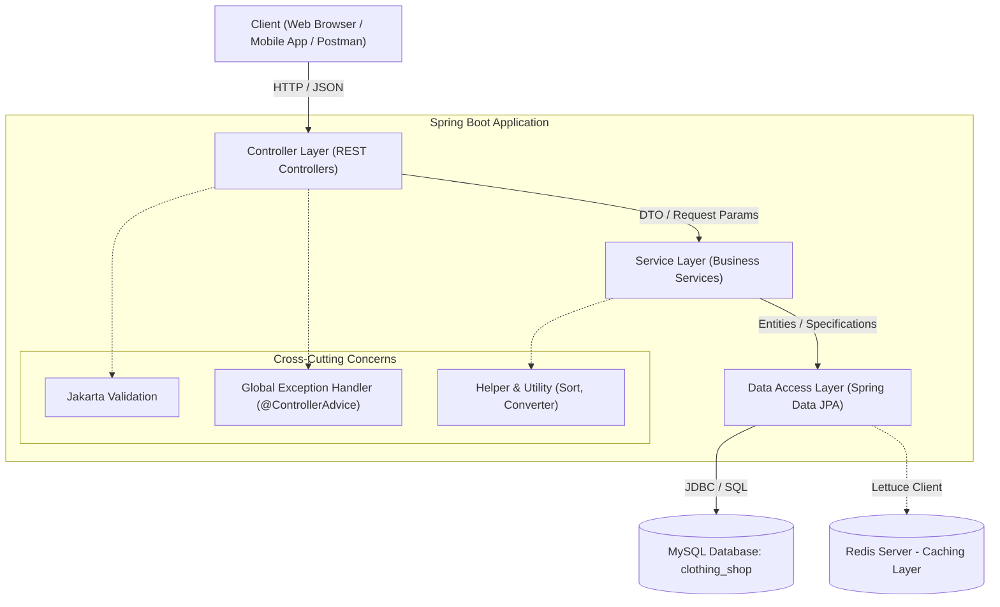
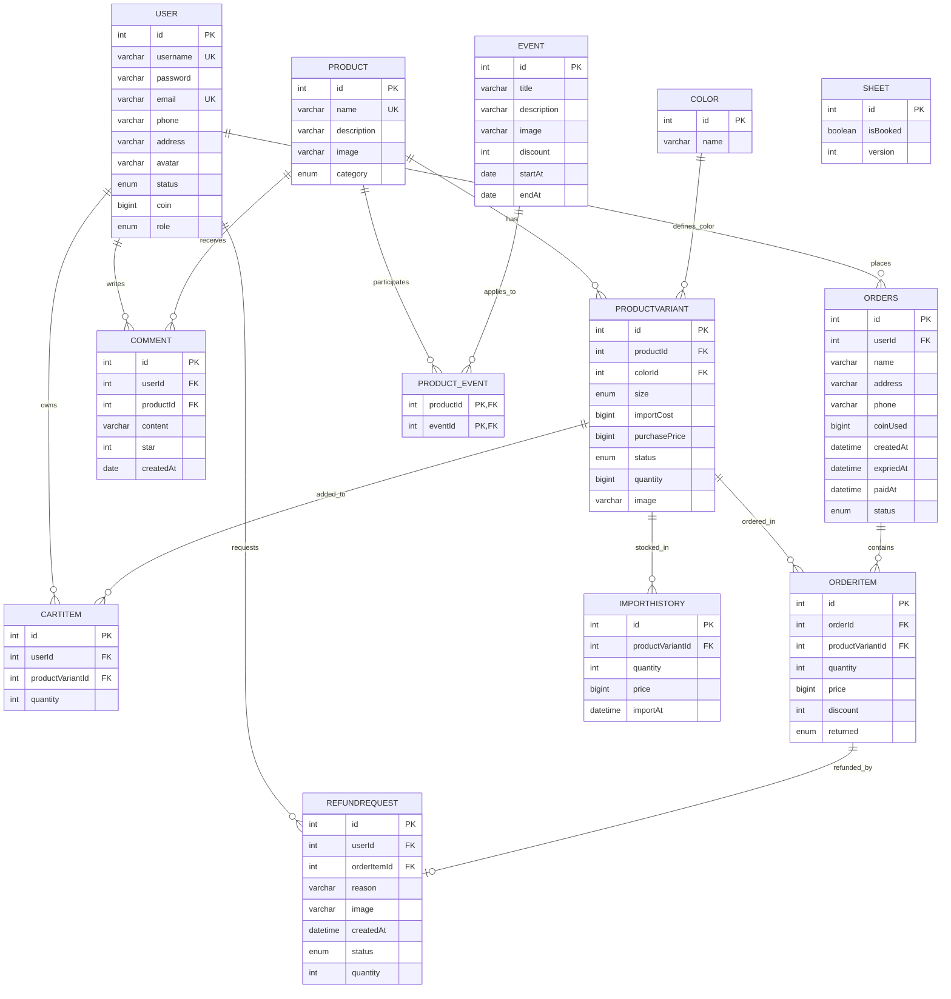
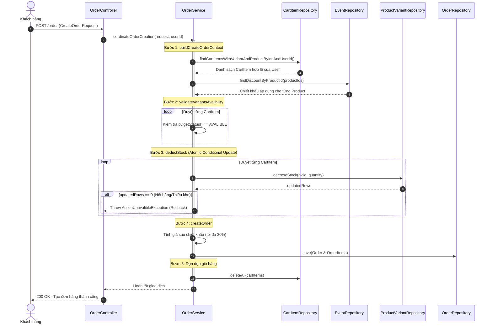
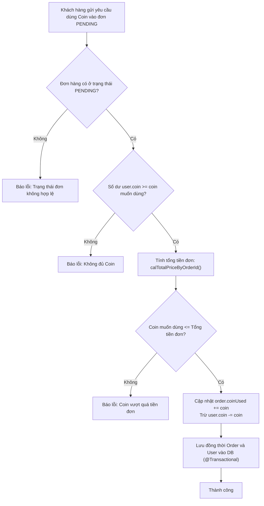

# TÀI LIỆU THIẾT KẾ KIẾN TRÚC CHI TIẾT (SYSTEM ARCHITECTURE DOCUMENT)
## HỆ THỐNG BACKEND THƯƠNG MẠI ĐIỆN TỬ CỬA HÀNG THỜI TRANG (CLOTHING SHOP)

---

## 1. TỔNG QUAN KIẾN TRÚC HỆ THỐNG (SYSTEM ARCHITECTURE OVERVIEW)

### 1.1. Phong cách kiến trúc (Architectural Style)
Hệ thống **Clothing Shop Backend** được xây dựng dựa trên phong cách **Kiến trúc Phân tầng Đa lớp (Layered / N-Tier Architecture)** trên nền tảng **Spring Boot**, kết hợp với mô hình **Domain-Centric Data Access** thông qua Spring Data JPA và Hibernate ORM.

Kiến trúc này phân tách rõ ràng trách nhiệm giữa các tầng (Separation of Concerns):
- **Giao diện lập trình (Presentation / Controller Layer):** Đón nhận các yêu cầu HTTP RESTful, xác thực dữ liệu đầu vào (Bean Validation), đóng gói phản hồi chuẩn hóa theo định dạng `ApiResponse<T>`.
- **Tầng Nghiệp vụ (Business / Service Layer):** Chứa toàn bộ logic nghiệp vụ, quy tắc kiểm tra tính hợp lệ của đơn hàng, tính toán chiết khấu, điều phối giao dịch (`@Transactional`) và điều phối xử lý theo mô hình Context Pattern (`CreateOrderContext`).
- **Tầng Truy xuất Dữ liệu (Persistence / Repository Layer):** Tương tác với cơ sở dữ liệu MySQL thông qua Spring Data JPA, hỗ trợ truy vấn động với JPA Specification, tối ưu hiệu năng với Projection Interface và kiểm soát đồng thời (Pessimistic/Optimistic Locking).
- **Tầng Lưu trữ & Bộ đệm (Storage & Database Layer):** Cơ sở dữ liệu quan hệ MySQL 8.x làm kho lưu trữ chính, sẵn sàng tích hợp Redis làm bộ nhớ đệm (Cache) tốc độ cao.



---

## 2. NGĂN XẾP CÔNG NGHỆ (TECHNOLOGY STACK)

| Thành phần | Công nghệ / Thư viện | Phiên bản | Mục đích sử dụng |
| :--- | :--- | :---: | :--- |
| **Ngôn ngữ lập trình** | Java (OpenJDK) | 17 (LTS) | Nền tảng thực thi chính, hỗ trợ các tính năng hiện đại (Pattern Matching, Records, Text Blocks) |
| **Framework nền tảng** | Spring Boot | 4.0.2 / 3.x | Khung phát triển ứng dụng doanh nghiệp toàn diện |
| **Tầng Web / REST** | Spring Boot Starter WebMVC | Built-in | Xây dựng RESTful API Controller, xử lý HTTP request/response |
| **Tầng ORM / Dữ liệu** | Spring Data JPA / Hibernate | Built-in | Quản lý thực thể, ánh xạ quan hệ (Object-Relational Mapping), sinh truy vấn SQL tự động |
| **Trình điều khiển CSDL** | MySQL Connector/J | 8.x | Kết nối ứng dụng Java với hệ quản trị CSDL MySQL |
| **Cơ sở dữ liệu** | MySQL Server | 8.0.43 | Hệ quản trị cơ sở dữ liệu quan hệ lưu trữ toàn bộ dữ liệu nghiệp vụ |
| **Bộ đệm dữ liệu (Cache)**| Spring Data Redis + Lettuce Core | 6.7.1.RELEASE | Bộ nhớ đệm phân tán hỗ trợ tăng tốc độ truy vấn dữ liệu ít biến động |
| **Xác thực dữ liệu** | Spring Starter Validation (Jakarta Validation) | 3.1.1 | Kiểm tra tính hợp lệ của DTO đầu vào bằng các Annotation (`@NotNull`, `@NotBlank`, `@Min`, `@Max`, `@AssertTrue`) |
| **Giảm thiểu Boilerplate** | Project Lombok | 1.18.42 | Tự động sinh Getter, Setter, Constructor, Builder pattern, giảm mã lặp lại |
| **Công cụ xây dựng** | Apache Maven | 3.9+ | Quản lý thư viện phụ thuộc và tiến trình đóng gói ứng dụng |

---

## 3. THIẾT KẾ CƠ SỞ DỮ LIỆU CHI TIẾT (DATABASE DESIGN & ERD)

### 3.1. Sơ đồ quan hệ thực thể (Entity Relationship Diagram - ERD)



---

### 3.2. Từ điển dữ liệu chi tiết (Data Dictionary)

#### 1. Bảng `user` (Tài khoản người dùng)
- **Mục đích:** Lưu trữ thông tin định danh, tài khoản đăng nhập, thông tin liên lạc và số dư xu tích lũy.
- **Ràng buộc:** `username` UNIQUE, `email` UNIQUE.

| Cột (Column) | Kiểu dữ liệu (Data Type) | Ràng buộc | Mô tả |
| :--- | :--- | :--- | :--- |
| `id` | `INT` | PK, AUTO_INCREMENT | Khóa chính định danh người dùng |
| `username` | `VARCHAR(255)` | UNIQUE, NULL | Tên tài khoản người dùng |
| `password` | `VARCHAR(255)` | NOT NULL | Mật khẩu tài khoản (dạng mã hóa hoặc plain text) |
| `email` | `VARCHAR(255)` | UNIQUE, NOT NULL | Địa chỉ email liên lạc |
| `phone` | `VARCHAR(255)` | DEFAULT '' | Số điện thoại người dùng |
| `address` | `VARCHAR(255)` | DEFAULT '' | Địa chỉ nơi ở mặc định |
| `avatar` | `VARCHAR(255)` | DEFAULT '' | Đường dẫn tệp ảnh đại diện |
| `status` | `ENUM('ACTIVE', 'PENDING')` | NOT NULL, DEFAULT 'ACTIVE' | Trạng thái hoạt động của tài khoản |
| `coin` | `BIGINT` | NOT NULL, DEFAULT 0 | Số dư Coin tích lũy dùng giảm giá đơn hàng |
| `role` | `ENUM('ADMIN', 'USER')` | NOT NULL, DEFAULT 'USER' | Phân quyền truy cập hệ thống |

#### 2. Bảng `product` (Thông tin sản phẩm cha)
- **Mục đích:** Lưu trữ thông tin chung của sản phẩm thời trang.
- **Ràng buộc:** `name` UNIQUE.

| Cột (Column) | Kiểu dữ liệu (Data Type) | Ràng buộc | Mô tả |
| :--- | :--- | :--- | :--- |
| `id` | `INT` | PK, AUTO_INCREMENT | Khóa chính sản phẩm |
| `name` | `VARCHAR(255)` | UNIQUE, NOT NULL | Tên hiển thị của sản phẩm |
| `description` | `VARCHAR(255)` | NULL | Mô tả chi tiết sản phẩm |
| `image` | `VARCHAR(255)` | NOT NULL | Đường dẫn ảnh sản phẩm |
| `category` | `ENUM('PANTS','SHIRT','DRESS','SET','SPORTSWEAR')` | NOT NULL | Danh mục phân loại mặt hàng |

#### 3. Bảng `color` (Bảng danh mục màu sắc)
- **Mục đích:** Định nghĩa các màu sắc chuẩn của trang phục.

| Cột (Column) | Kiểu dữ liệu (Data Type) | Ràng buộc | Mô tả |
| :--- | :--- | :--- | :--- |
| `id` | `INT` | PK, AUTO_INCREMENT | Khóa chính màu |
| `name` | `VARCHAR(255)` | NOT NULL | Tên màu sắc (Đỏ, Trắng, Xanh, ...) |

#### 4. Bảng `productvariant` (Biến thể sản phẩm - SKU)
- **Mục đích:** Quản lý chi tiết từng phiên bản của sản phẩm theo kích cỡ, màu sắc, giá bán và lượng tồn.
- **Ràng buộc:** FK `productId` -> `product(id)` ON DELETE CASCADE; FK `colorId` -> `color(id)` ON DELETE CASCADE.

| Cột (Column) | Kiểu dữ liệu (Data Type) | Ràng buộc | Mô tả |
| :--- | :--- | :--- | :--- |
| `id` | `INT` | PK, AUTO_INCREMENT | Khóa chính biến thể |
| `productId` | `INT` | FK, NOT NULL | Khóa ngoại tham chiếu đến sản phẩm cha |
| `colorId` | `INT` | FK, NOT NULL | Khóa ngoại tham chiếu đến màu sắc |
| `size` | `ENUM('S','M','L','XL','XXL','XXXL')` | NOT NULL, DEFAULT 'L' | Kích thước trang phục |
| `importCost` | `BIGINT` | NOT NULL | Giá vốn nhập kho |
| `purchasePrice`| `BIGINT` | NOT NULL | Giá niêm yết bán lẻ ra thị trường |
| `status` | `ENUM('COMING','AVALIBLE','UNAVALIBLE')`| NOT NULL, DEFAULT 'AVALIBLE' | Trạng thái kinh doanh của biến thể |
| `quantity` | `BIGINT` | NOT NULL, DEFAULT 0 | Số lượng sản phẩm còn tồn kho |
| `image` | `VARCHAR(255)` | NOT NULL, DEFAULT '' | Hình ảnh biến thể theo màu |

#### 5. Bảng `event` (Sự kiện khuyến mãi)
- **Mục đích:** Quản lý chiến dịch giảm giá theo thời gian.
- **Ràng buộc:** CHECK (`discount` <= 30), CHECK (`endAt` > `startAt`).

| Cột (Column) | Kiểu dữ liệu (Data Type) | Ràng buộc | Mô tả |
| :--- | :--- | :--- | :--- |
| `id` | `INT` | PK, AUTO_INCREMENT | Khóa chính sự kiện |
| `title` | `VARCHAR(255)` | NOT NULL | Tiêu đề chiến dịch khuyến mãi |
| `description` | `VARCHAR(255)` | NULL | Nội dung chi tiết sự kiện |
| `image` | `VARCHAR(255)` | NOT NULL | Banner / ảnh đại diện sự kiện |
| `discount` | `INT` | NOT NULL, CHECK <= 30 | Phần trăm giảm giá (tối đa 30%) |
| `startAt` | `DATE` | NOT NULL | Ngày bắt đầu áp dụng |
| `endAt` | `DATE` | NOT NULL, CHECK > startAt | Ngày kết thúc sự kiện |

#### 6. Bảng `product_event` (Liên kết Sản phẩm - Sự kiện)
- **Mục đích:** Bảng nối mối quan hệ N - N giữa `product` và `event`.
- **Ràng buộc:** PK (`productId`, `eventId`), FKs ON DELETE CASCADE.

#### 7. Bảng `orders` (Đơn đặt hàng)
- **Mục đích:** Lưu trữ đơn hàng do khách hàng tạo ra.
- **Ràng buộc:** FK `userId` -> `user(id)` ON DELETE CASCADE.

| Cột (Column) | Kiểu dữ liệu (Data Type) | Ràng buộc | Mô tả |
| :--- | :--- | :--- | :--- |
| `id` | `INT` | PK, AUTO_INCREMENT | Khóa chính đơn hàng |
| `userId` | `INT` | FK, NOT NULL | Khóa ngoại người đặt hàng |
| `name` | `VARCHAR(255)` | NOT NULL | Tên người nhận hàng |
| `address` | `VARCHAR(255)` | NOT NULL | Địa chỉ giao hàng chi tiết |
| `phone` | `VARCHAR(255)` | NULL | Số điện thoại liên hệ giao nhận |
| `coinUsed` | `BIGINT` | NOT NULL, DEFAULT 0 | Số lượng Coin đã trừ vào đơn |
| `createdAt` | `DATETIME` | NOT NULL, DEFAULT NOW() | Thời điểm tạo đơn |
| `expriedAt` | `DATETIME` | NOT NULL | Hạn thanh toán (mặc định createdAt + 1 ngày) |
| `paidAt` | `DATETIME` | NULL | Thời điểm thanh toán thành công |
| `status` | `ENUM('PENDING','PAID','CANCEL','EXPRIED','DELIVERIED')` | NOT NULL, DEFAULT 'PENDING' | Trạng thái xử lý của đơn |

#### 8. Bảng `orderitem` (Chi tiết mặt hàng trong đơn)
- **Mục đích:** Lưu trữ các biến thể sản phẩm cụ thể thuộc đơn hàng, bảo lưu giá bán và tỷ lệ chiết khấu tại thời điểm đặt hàng.
- **Ràng buộc:** FK `orderId` -> `orders(id)`, FK `productVariantId` -> `productvariant(id)`.

| Cột (Column) | Kiểu dữ liệu (Data Type) | Ràng buộc | Mô tả |
| :--- | :--- | :--- | :--- |
| `id` | `INT` | PK, AUTO_INCREMENT | Khóa chính dòng đơn hàng |
| `orderId` | `INT` | FK, NOT NULL | Khóa ngoại đơn hàng |
| `productVariantId` | `INT` | FK, NOT NULL | Khóa ngoại biến thể sản phẩm |
| `quantity` | `INT` | NOT NULL | Số lượng mua |
| `price` | `BIGINT` | NOT NULL | Giá sau khi đã áp dụng chiết khấu |
| `discount` | `INT` | NOT NULL, DEFAULT 0 | Tỷ lệ phần trăm giảm giá lúc mua |
| `returned` | `ENUM('FALSE','TRUE','PENDING')` | NOT NULL, DEFAULT 'FALSE' | Trạng thái đổi trả của mục hàng này |

#### 9. Bảng `cartitem` (Giỏ hàng của khách hàng)
- **Mục đích:** Lưu trữ các sản phẩm được đưa vào giỏ trước khi thanh toán.

| Cột (Column) | Kiểu dữ liệu (Data Type) | Ràng buộc | Mô tả |
| :--- | :--- | :--- | :--- |
| `id` | `INT` | PK, AUTO_INCREMENT | Khóa chính mục giỏ hàng |
| `userId` | `INT` | FK, NOT NULL | Khóa ngoại người sở hữu giỏ |
| `productVariantId` | `INT` | FK, NOT NULL | Khóa ngoại biến thể được chọn |
| `quantity` | `INT` | NOT NULL | Số lượng chọn mua |

#### 10. Bảng `comment` (Bình luận & Đánh giá)
- **Mục đích:** Lưu trữ đánh giá của khách hàng cho sản phẩm.

| Cột (Column) | Kiểu dữ liệu (Data Type) | Ràng buộc | Mô tả |
| :--- | :--- | :--- | :--- |
| `id` | `INT` | PK, AUTO_INCREMENT | Khóa chính bình luận |
| `userId` | `INT` | FK, NOT NULL | Khóa ngoại người viết bình luận |
| `productId` | `INT` | FK, NOT NULL | Khóa ngoại sản phẩm được đánh giá |
| `content` | `VARCHAR(255)` | NULL | Nội dung nhận xét |
| `star` | `INT` | NOT NULL | Số sao đánh giá (từ 1 đến 5) |
| `createdAt` | `DATE` | NOT NULL, DEFAULT CURDATE()| Ngày đăng bình luận |

#### 11. Bảng `importhistory` (Lịch sử nhập kho)
- **Mục đích:** Ghi vết mọi lần nhập hàng vào kho phục vụ kiểm kê, tính toán giá vốn và báo cáo chi phí.

| Cột (Column) | Kiểu dữ liệu (Data Type) | Ràng buộc | Mô tả |
| :--- | :--- | :--- | :--- |
| `id` | `INT` | PK, AUTO_INCREMENT | Khóa chính bản ghi nhập |
| `productVariantId` | `INT` | FK, NOT NULL | Biến thể được nhập |
| `quantity` | `INT` | NOT NULL | Số lượng nhập thêm |
| `price` | `BIGINT` | NOT NULL | Đơn giá vốn nhập tại thời điểm đó |
| `importAt` | `DATETIME` | NOT NULL, DEFAULT NOW() | Thời điểm nhập kho |

#### 12. Bảng `refundrequest` (Yêu cầu đổi trả / hoàn tiền)
- **Mục đích:** Quản lý quy trình khiếu nại, trả hàng và hoàn tiền của khách hàng đối với từng dòng sản phẩm đã mua.

| Cột (Column) | Kiểu dữ liệu (Data Type) | Ràng buộc | Mô tả |
| :--- | :--- | :--- | :--- |
| `id` | `INT` | PK, AUTO_INCREMENT | Khóa chính yêu cầu hoàn trả |
| `userId` | `INT` | FK, NOT NULL | Khóa ngoại người yêu cầu |
| `orderItemId` | `INT` | FK, NOT NULL | Mục hàng cần trả |
| `reason` | `VARCHAR(255)` | NULL | Lý do yêu cầu trả hàng |
| `image` | `VARCHAR(255)` | NOT NULL | Ảnh chụp minh chứng lỗi/hỏng |
| `quantity` | `INT` | NOT NULL, DEFAULT 1 | Số lượng muốn hoàn trả |
| `status` | `ENUM('PENDING','ACCEPTED','REJECTED','DONE')` | DEFAULT 'PENDING' | Trạng thái phê duyệt yêu cầu |
| `createdAt` | `DATETIME(6)` | NULL | Thời điểm gửi yêu cầu |

#### 13. Bảng `sheet` (Thử nghiệm cơ chế Concurrency)
- **Mục đích:** Module độc lập kiểm chứng cơ chế khóa lạc quan (Optimistic Locking) và khóa bi quan (Pessimistic Locking) trong đặt chỗ/tài nguyên hạn chế.

| Cột (Column) | Kiểu dữ liệu (Data Type) | Ràng buộc | Mô tả |
| :--- | :--- | :--- | :--- |
| `id` | `INT` | PK, AUTO_INCREMENT | Mã định danh vị trí/ghế |
| `isBooked` | `BOOLEAN` | DEFAULT FALSE | Trạng thái đã được giữ chỗ |
| `version` | `INT` | `@Version` | Trường phiên bản phục vụ Optimistic Locking |

---

## 4. CHI TIẾT THIẾT KẾ CÁC TẦNG ỨNG DỤNG (APPLICATION LAYER DESIGN)

### 4.1. Tầng Controller (REST API Endpoints)
Tầng Controller chịu trách nhiệm nhận HTTP Request, gọi tầng Validation và chuyển tiếp xuống Service tương ứng.

#### Bảng tổng hợp Endpoints của hệ thống:

| STT | Nhóm chức năng | Endpoint | Phương thức | DTO Request | DTO Response | Mô tả |
| :---: | :--- | :--- | :---: | :--- | :--- | :--- |
| 1 | **Xác thực** | `/auth/register` | `POST` | `CreateNewUserRequest` | `ApiResponse<String>` | Đăng ký tài khoản người dùng mới |
| 2 | **Người dùng** | `/user` | `PUT` | `ChangePasswordRequest`| `ApiResponse<String>` | Thay đổi mật khẩu người dùng |
| 3 | **Người dùng** | `/user` | `GET` | Params: `keyword, page, size, sortBy, sortDir` | `ApiResponse<Page<UserInfoWithoutPassProjection>>` | Tìm kiếm người dùng có phân trang và sắp xếp |
| 4 | **Sản phẩm** | `/product` | `POST` | `CreateNewProductRequest` | `ApiResponse<String>` | Thêm sản phẩm mới |
| 5 | **Sản phẩm** | `/product/{productId}` | `PUT` | `UpdateProductRequest` | `ApiResponse<String>` | Cập nhật thông tin sản phẩm cha |
| 6 | **Sản phẩm** | `/product` | `GET` | Params: `page, size, productName, category, sortBy, sortDir` | `ApiResponse<Page<ProductProjection>>` | Tra cứu, lọc sản phẩm theo danh mục và tên |
| 7 | **Biến thể** | `/variant` | `POST` | `ImportVariantRequest`, Param: `productId` | `ApiResponse<String>` | Nhập kho, tạo mới hoặc tăng tồn kho biến thể |
| 8 | **Sự kiện** | `/event` | `POST` | `CreateNewEventRequest`| `ApiResponse<String>` | Tạo sự kiện khuyến mãi mới |
| 9 | **Sự kiện** | `/event/{eventId}` | `PUT` | `UpdateEventRequest` | `ApiResponse<String>` | Cập nhật sự kiện và danh sách sản phẩm áp dụng |
| 10 | **Sự kiện** | `/event` | `GET` | Params: `keyword, status, page, size, startAt, endAt, sortBy, sortDir` | `ApiResponse<Page<EventProjection>>` | Lọc sự kiện theo từ khóa, trạng thái, khoảng ngày |
| 11 | **Sự kiện** | `/event/detail/{eventId}`| `GET` | Path: `eventId` | `ApiResponse<EventWithAppliedProducts>` | Xem chi tiết sự kiện kèm danh sách sản phẩm |
| 12 | **Giỏ hàng** | `/cart/item/{productVariantId}`| `POST` | Path: `productVariantId` | `ApiResponse<String>` | Thêm biến thể sản phẩm vào giỏ hàng |
| 13 | **Giỏ hàng** | `/cart/item` | `DELETE`| Param: `ids` (Set Integer) | `ApiResponse<String>` | Xóa danh sách mặt hàng khỏi giỏ |
| 14 | **Giỏ hàng** | `/cart` | `GET` | Param: `page` | `ApiResponse<Page<CartItemWithProductVariant>>` | Lấy danh sách sản phẩm trong giỏ của user |
| 15 | **Bình luận**| `/product/{productId}/comment/`| `POST`| `PostNewCommentRequest`| `ApiResponse<String>` | Đăng bình luận cho sản phẩm |
| 16 | **Bình luận**| `/product/{productId}/comment` | `GET` | Params: `sortBy, sortDir` | `ApiResponse<List<CommentWithUser>>` | Lấy danh sách bình luận theo sản phẩm |
| 17 | **Đơn hàng** | `/order/price/{orderId}` | `GET` | Path: `orderId` | `String` (Tổng tiền) | Tính tổng số tiền phải trả của đơn hàng |
| 18 | **Đơn hàng** | `/order` | `POST` | `CreateOrderRequest` | `ApiResponse<String>` | Khởi tạo đơn hàng (Orchestration & Trừ kho) |
| 19 | **Đơn hàng** | `/order/{orderId}/detail` | `PUT` | `UpdateOrderInfoRequest` | `ApiResponse<String>` | Cập nhật địa chỉ nhận hàng và áp dụng Coin |
| 20 | **Đơn hàng** | `/order/{orderId}/detail/cancel`| `PUT`| Path: `orderId` | `ApiResponse<String>` | Hủy đơn hàng và tự động hoàn trả tồn kho |
| 21 | **Đơn hàng** | `/order` | `GET` | Params: `status, page, size, startAt, endAt, reciverName, address, phone, sortBy, sortDir` | `ApiResponse<Page<OrderProjection>>` | Tra cứu đơn hàng động theo nhiều tiêu chí |
| 22 | **Đơn hàng** | `/order/{orderId}/detail` | `GET` | Path: `orderId` | `ApiResponse<OrderWithItems>` | Xem chi tiết đơn hàng đầy đủ kèm các mục hàng |
| 23 | **Thử nghiệm**| `/book/{sheetId}` | `GET` | Path: `sheetId` | `ApiResponse<String>` | Đặt chỗ ghế thử nghiệm Concurrency Lock |

---

### 4.2. Tầng Nghiệp vụ & Điều phối giao dịch (Service Layer & Orchestration)

#### 1. Quy trình điều phối tạo đơn hàng (`cordinateOrderCreation`):
Sử dụng **Context Pattern** thông qua lớp `CreateOrderContext` để chuyển giao dữ liệu an toàn và xuyên suốt giữa các bước nội bộ:



#### 2. Quy trình áp dụng xu (Coin Management):


---

### 4.3. Tầng Truy xuất dữ liệu (Data Access Layer & Query Optimization)

#### 1. Xây dựng truy vấn động với JPA Specifications:
Hệ thống sử dụng `JpaSpecificationExecutor<T>` kết hợp lớp tiện ích tĩnh để sinh mệnh đề `WHERE` động theo thời gian thực mà không cần viết các câu lệnh SQL ghép chuỗi rườm rà:
- `ProductSpecification`: Lọc theo danh mục (`hasCategory`), tìm kiếm theo tên (`hasName`).
- `OrderSpecification`: Lọc theo trạng thái (`hasStatus`), khoảng thời gian tạo (`isCreatedBetWeen`), số điện thoại (`hasPhone`), tên người nhận (`hasReciverName`), địa chỉ (`hasAddress`).
- `EventSpecification`: Lọc theo tiêu đề (`hasTitle`), trạng thái thời gian (`hasStatus`: ended / coming / available), khoảng hiệu lực (`isAvailableBetween`).
- `UserSpecification`: Tìm theo username (`hasUsername`), loại bỏ tài khoản Admin (`notHasRole(ADMIN)`).

#### 2. Tối ưu hóa hiệu năng với Spring Data Projection Interfaces:
Thay vì truy vấn toàn bộ thực thể với nhiều trường không cần thiết hoặc gây nguy cơ bảo mật, hệ thống sử dụng các interface projection:
- `UserInfoWithoutPassProjection`: Ẩn trường mật khẩu khi trả thông tin người dùng ra API.
- `ProductProjection`: Chỉ lấy các trường cơ bản hiển thị danh sách (`id`, `name`, `image`, `category`).
- `OrderProjection`: Tối ưu bảng hiển thị danh sách đơn hàng.
- `OrderWithItems`, `ProductWithVariantsAndComments`: Ánh xạ cấu trúc lồng nhau phân cấp giúp giảm thiểu số lượng truy vấn xuống CSDL.

#### 3. Xử lý triệt để bài toán N+1 Queries:
- **`@EntityGraph`:** Được cấu hình trên các phương thức Repository (như `findUserDtoWithCartItemsById`, `findEventWithAppliedProductsById`) để ép Hibernate nạp sẵn các tập hợp liên quan trong 1 truy vấn `LEFT OUTER JOIN`.
- **`JOIN FETCH`:** Được sử dụng tường minh trong các câu JPQL phức tạp (như `findOrderWithItemsAndVariantsById`, `findCartItemsWithVariantAndProductByIdsAndUserId`) để eager load chính xác các thuộc tính phục vụ nghiệp vụ mà vẫn giữ cấu hình chung là `FetchType.LAZY`.

---

## 5. CƠ CHẾ ĐỒNG THỜI VÀ KIỂM SOÁT GIAO DỊCH (CONCURRENCY CONTROL)

Trong các hệ thống thương mại điện tử, tình trạng nhiều người dùng đồng thời mua cùng một sản phẩm tồn kho có số lượng giới hạn rất dễ dẫn đến **Overselling (Bán âm kho)**. Mã nguồn của dự án áp dụng 3 cấp độ phòng thủ:

### 5.1. Atomic Conditional Update (Cập nhật có điều kiện ở tầng Database)
Trong `ProductVariantRepository.java`:
```java
@Modifying
@Query("""
    UPDATE ProductVariant pv
    SET pv.quantity = pv.quantity - :quantity
    WHERE pv.id = :productVariantId AND pv.quantity >= :quantity
""")
public Integer decreseStock(@Param("productVariantId") Integer productVariantId,
                            @Param("quantity") Integer quantity);
```
- **Cơ chế hoạt động:** Sử dụng cơ chế Row-level Lock nội tại của MySQL (InnoDB). Mệnh đề `AND pv.quantity >= :quantity` đảm bảo rằng chỉ khi số lượng tồn kho còn đủ, bản ghi mới được cập nhật.
- **Giá trị trả về:** `updatedRows` (số dòng bị ảnh hưởng). Nếu `updatedRows == 0`, Service biết ngay rằng hàng đã hết hoặc không đủ và lập tức ngắt giao dịch ném ngoại lệ `ActionUnavalibleException`.

### 5.2. Pessimistic Write Lock (Khóa bi quan)
Trong `ProductVariantRepository.java` và `SheetRepository.java`:
```java
@Lock(LockModeType.PESSIMISTIC_WRITE)
@Query("SELECT pv FROM ProductVariant pv WHERE pv.id = :variantId")
public Optional<ProductVariant> findVariantByIdWithPresLock(@Param("variantId") Integer variantId);
```
- Khi câu lệnh này thực thi, Hibernate sinh ra câu lệnh `SELECT ... FOR UPDATE` trong MySQL.
- Bất kỳ Transaction nào khác muốn đọc hoặc ghi vào bản ghi biến thể này đều phải chờ cho đến khi Transaction hiện tại hoàn tất (`COMMIT` hoặc `ROLLBACK`). Phương pháp này đảm bảo tính tuần tự tuyệt đối khi cần cập nhật các thông số nhạy cảm như giá bán và số lượng điều chỉnh thủ công.

### 5.3. Optimistic Lock (Khóa lạc quan với `@Version`)
Trong module `sheet_booking` (`SheetEntity.java`):
```java
@Version
private Integer version;
```
- Mỗi khi một dòng được cập nhật, Hibernate tự động so sánh và tăng giá trị `version`:
  `UPDATE sheet SET isBooked = true, version = version + 1 WHERE id = ? AND version = ?`
- Nếu có một Transaction khác đã cập nhật trước đó, số phiên bản không còn khớp, hệ thống sẽ ném ra `OptimisticLockException`, ngăn chặn việc ghi đè mất mát dữ liệu (Lost Update).

---

## 6. XỬ LÝ NGOẠI LỆ & TIÊU CHUẨN PHẢN HỒI (EXCEPTION HANDLING & API RESPONSE)

### 6.1. Cấu trúc chuẩn của phản hồi (Uniform Response Structure)
Tất cả các API Controller đều trả về đối tượng `ApiResponse<T>`:
```java
public class ApiResponse<T> {
    private int code;       // Mã HTTP hoặc mã trạng thái tùy chỉnh (200, 201, 400, 404, 500)
    private String message; // Thông điệp phản hồi mô tả kết quả
    private T data;         // Dữ liệu nghiệp vụ trả về (Đối tượng DTO, Danh sách, Phân trang)
}
```

### 6.2. Cơ chế bắt ngoại lệ toàn cục (`@ControllerAdvice`)
Được hiện thực trong lớp `ExceptionController.java`:
- **`NotFoundException`:** Chuyển đổi thành HTTP 404 Not Found khi không tìm thấy tài nguyên (sản phẩm, đơn hàng, người dùng).
- **`ActionUnavalibleException`:** Chuyển đổi thành HTTP 400 Bad Request khi vi phạm các quy tắc nghiệp vụ (hết hàng, trùng lặp tên, trạng thái không hợp lệ, coin không đủ).
- **`MethodArgumentNotValidException`:** Chuyển đổi thành HTTP 400 Bad Request, trích xuất chính xác thông báo lỗi từ các bean validation annotation đầu tiên và trả về cho client.
- **`RuntimeException`:** Chuyển đổi thành HTTP 500 Internal Server Error cho các lỗi không mong muốn từ hệ thống.

---

## 7. PHÂN TÍCH NỢ KỸ THUẬT, LỖI TIỀM ẨN VÀ ĐIỂM CẦN KHẮC PHỤC (CODE REVIEW & BUGS ANALYSIS)

Qua việc đọc và phân tích toàn diện mã nguồn, đã phát hiện một số điểm lỗi logic, cấu hình và nợ kỹ thuật quan trọng cần được lưu ý và khắc phục:

> [!CAUTION] 
> ### Bug logic nghiêm trọng trong `OrderService.java`
> Tại dòng 122 - 123 của `OrderService.java`:
> ```java
> Map<Integer, Integer> discountMapByProductId = context.getDiscountMap();
> Map<Integer, Integer> quantityMapByCartItemId = context.getDiscountMap(); // BUG TẠI ĐÂY!
> ```
> **Hậu quả:** Biến `quantityMapByCartItemId` bị gán nhầm bằng `context.getDiscountMap()` thay vì `context.getQuantityMap()`. Khi vòng lặp tạo `OrderItem` thực hiện `quantityMapByCartItemId.get(cartItem.getId())`, do Map chứa key là `productId` chứ không phải `cartItemId`, giá trị lấy ra có thể bị `null` hoặc sai lệch hoàn toàn, dẫn đến lỗi tạo đơn hàng!
> **Khắc phục:** Sửa thành `Map<Integer, Integer> quantityMapByCartItemId = context.getQuantityMap();`.

> [!WARNING]
> ### Lỗi cú pháp câu JPQL trong `ProductRepository.java`
> Tại phương thức `findProductWithVariantsAndCommentsById`:
> ```java
> @Query("""
>     SELECT p
>     FROM Product p
>     JOIN FETCH p.productVariants pv
>     JOIN FETCH pv.p p_             <-- LỖI CÚ PHÁP THUỘC TÍNH: pv.p không tồn tại
>     JOIN FETCH p.comments c 
>     WHERE p.id = :productId
> """)
> ```
> **Hậu quả:** Trong thực thể `ProductVariant`, thuộc tính liên kết là `product`, không có thuộc tính `p`. Câu query này khi được Hibernate phân tích sẽ gây lỗi `QuerySyntaxException`. Đồng thời, việc `JOIN FETCH` cùng lúc 2 collection (`productVariants` và `comments`) sẽ gây lỗi `MultipleBagFetchException` trong Hibernate nếu dùng List hoặc tích Đề-các bùng nổ dữ liệu.
> **Khắc phục:** Sửa thành `JOIN FETCH pv.product` và nên tách việc fetch comments thành truy vấn độc lập hoặc dùng Set.

> [!NOTE]
> ### Import nhầm thư viện trong `ProductVariantController.java`
> Tại dòng 14 và 28:
> `import jakarta.websocket.server.PathParam;`
> và sử dụng `@PathParam(value = "productId") Integer productId`.
> **Khắc phục:** Cần đổi thành `@RequestParam(value = "productId")` chuẩn của Spring Web (`org.springframework.web.bind.annotation.RequestParam`).

> [!TIP]
> ### Lỗi cấu hình trong `application.yaml`
> Tại dòng 22:
> `host: locahost` -> Sai chính tả `locahost`, đúng phải là `localhost`.

> [!IMPORTANT]
> ### Tình trạng phân quyền và bảo mật (Security Status)
> - Các dependency liên quan đến Spring Security và JJWT trong `pom.xml` hiện đang bị comment tạm thời.
> - `AuthService.java` hiện đang trả về ID người dùng hardcoded là `2` (`return 2;`). Các API đăng nhập, làm mới token, phân quyền `@PreAuthorize` đang bị đóng.
> - Cần sớm hoàn thiện tích hợp Spring Security 6 với JWT Filter để bảo vệ các endpoint theo đúng ma trận phân quyền đã thiết kế.

---

## 8. LỘ TRÌNH NÂNG CẤP & KHUYẾN NGHỊ KIẾN TRÚC (ENHANCEMENT ROADMAP)

1. **Sửa các lỗi logic đã phát hiện:** Khắc phục ngay bug gán `quantityMap` trong `OrderService`, sửa câu truy vấn JPQL trong `ProductRepository`, chuẩn hóa import `@RequestParam`.
2. **Kích hoạt Spring Security & JWT:** Mở lại cấu hình Spring Security, tích hợp `JwtAuthenticationFilter`, triển khai mã hóa mật khẩu với `BCryptPasswordEncoder` và trích xuất `userId` thực tế từ Security Context thay vì hardcode.
3. **Kích hoạt Caching với Redis:** Tận dụng thư viện Lettuce đã có, kích hoạt `@EnableCaching` và sử dụng `@Cacheable` cho các dữ liệu ít thay đổi nhưng tần suất đọc cao (như danh sách Category, chi tiết Product, các sự kiện giảm giá đang hiệu lực).
4. **Xử lý tác vụ nền tự động (Scheduled Tasks):** Lớp `ShopApplication` đã có `@EnableScheduling`. Cần bổ sung các Cron Job định kỳ:
   - Tự động quét và chuyển trạng thái các đơn hàng `PENDING` quá 24h sang `EXPRIED` và tự động hoàn trả tồn kho.
   - Tự động cập nhật trạng thái sự kiện khi đến hoặc qua ngày hiệu lực.
5. **Hoàn thiện các chức năng còn dang dở:**
   - Hoàn thiện nghiệp vụ thanh toán trực tuyến qua cổng thanh toán (`confirmPayedOrder` trong `OrderService`).
   - Tích hợp đầy đủ các API cho phân hệ Đổi/Trả hàng (`RefundRequestController` & `RefundRequestService`).

