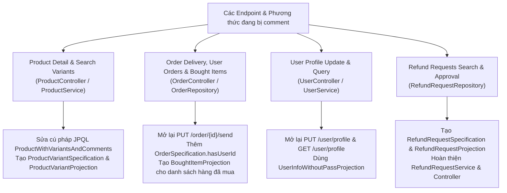
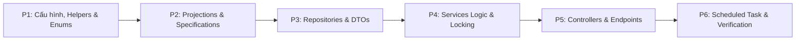

# KẾ HOẠCH CHI TIẾT SỬA LỖI, ĐỒNG BỘ VÀ TỐI ƯU HÓA HỆ THỐNG BACKEND
## DỰ ÁN: CLOTHING SHOP (BTL THỰC TẬP CƠ SỞ)
### Căn cứ thực hiện: [PRD.md](file:///d:/project/BTL-TTCS%20-%20Copy/BTL-TTCS/agent/PRD.md) và [ARCHITEC.md](file:///d:/project/BTL-TTCS%20-%20Copy/BTL-TTCS/agent/ARCHITEC.md)

---

## 1. MỤC TIÊU VÀ NGUYÊN TẮC CỐT LÕI (OBJECTIVES & PRINCIPLES)

1. **Bảo toàn 100% kiến trúc và luồng nghiệp vụ gốc:** Giữ nguyên mô hình Kiến trúc Phân tầng (Controller -> Service -> Repository -> MySQL/Redis), không thay đổi triết lý thiết kế hay đảo lộn luồng dữ liệu.
2. **Kế thừa và chuẩn hóa phong cách Specification & Projection:** Tái cấu trúc các endpoint đang bị comment theo đúng phong cách tác giả đã xây dựng trong dự án:
   - **JPA Specification:** Đặt trong package `repository.specification`, sử dụng các phương thức `public static Specification<T> hasXxx(...)` trả về lambda CriteriaBuilder `(root, query, cb) -> { ... }`.
   - **Spring Data Projection:** Đặt trong package `dto.projection_interface`, sử dụng các Interface lồng nhau (nested interfaces) để ánh xạ các quan hệ phân cấp kèm các phương thức `default String getName()` tiện ích.
   - **Tối ưu hóa truy vấn:** Sử dụng `repository.findBy(spec, q -> q.as(Projection.class).page(pageable))` để sinh SQL tối ưu, chỉ lấy các cột cần thiết và loại bỏ hoàn toàn các DTO Mapper thủ công cùng vấn đề N+1 queries.
3. **Khắc phục triệt để các lỗi logic nghiêm trọng:** Giải quyết dứt điểm các lỗi làm sai lệch dữ liệu kinh doanh (gán nhầm context map, tính chiết khấu 2 lần, tăng nhầm kho của sản phẩm khác khi nhập hàng, mất xu khi hủy đơn).
4. **Đảm bảo tính toàn vẹn và an toàn đồng thời (Concurrency Safety):** Triển khai cơ chế cập nhật có điều kiện nguyên tử (Atomic Conditional Update) và khóa giao dịch chống Race Condition trên số dư Coin của User và tồn kho biến thể.
5. **Cung cấp Checklist chi tiết:** Tạo bảng kiểm tra dạng checklist `- [ ]` ở cuối tài liệu để phục vụ việc rà soát và đánh giá khi tiến hành sửa code trong các bước tiếp theo.

---

## 2. ĐÁNH GIÁ & PHÂN TÍCH TỪNG ENDPOINT BỊ COMMENT TRONG DỰ ÁN

Hệ thống đã rà soát toàn bộ các khối mã nguồn đang bị comment trong Controllers, Services và Repositories để làm rõ mục đích và phương án chuẩn hóa:



---

### Bảng phân tích chi tiết từng Endpoint bị comment:

| Vị trí file | Endpoint / Phương thức bị comment | Hiện trạng & Lý do bị comment | Nhu cầu Specification / Projection | Kế hoạch triển khai theo Style tác giả |
| :--- | :--- | :--- | :---: | :--- |
| **ProductController** (dòng 98-109) | `GET /product/{productId}/detail` | Bị comment do câu JPQL trong `ProductRepository` lỗi cú pháp `pv.p p_` và getter `getCommments()` thừa chữ 'm' | **Projection có sẵn** (`ProductWithVariantsAndComments`) | Sửa câu JPQL, sửa getter thành `getComments()`, mở lại endpoint trong `ProductController` |
| **ProductController** (dòng 244-263) | `GET /product-variants` (tìm kiếm biến thể) | Dùng DTO thủ công `productMapper.toProductVariantDTO` gây N+1 queries khi nạp Product, Color | **CẦN Specification & Projection MỚI** | Tạo `ProductVariantSpecification` (lọc theo tên sản phẩm, màu sắc, kích cỡ, trạng thái) và `ProductVariantProjection`. Chuyển sang `ProductVariantController` |
| **ProductController** (dòng 265-276) | `GET /product-variant/{id}` (chi tiết biến thể) | Dùng DTO mapper cũ, chưa tối ưu | **CẦN Projection** | Dùng `ProductVariantProjection` để trả về chi tiết 1 biến thể nhanh gọn, không nạp dư thừa quan hệ |
| **ProductController** (dòng 278-289) | `PUT /product-variant` (cập nhật biến thể) | Bị comment vì chưa hoàn thiện DTO và locking | Không cần Specification | Mở lại dưới dạng `PUT /variant/{id}` trong `ProductVariantController`, gọi `productVariantService.updateExistingVariant` đã có sẵn Pessimistic Lock |
| **ProductController** (dòng 119-140, 228-241) | `GET /search`, `GET /products`, `GET /simple-products` | Các API tìm kiếm sản phẩm cũ dùng `ProductDTO` và `ProductSimpleDTO` | **ĐÃ CÓ** (`ProductSpecification` & `ProductProjection`) | Đã được thay thế bằng `GET /product` hiện hành với `ProductSpecification` + `ProductProjection`. Giữ nguyên code hiện tại, dọn dẹp code rác bị comment |
| **OrderController** (dòng 236-248) | `PUT /set-sending/{orderId}` (Admin xác nhận giao hàng) | Bị comment do trước đó có `@PreAuthorize` chưa hoàn thiện auth | Không cần | Mở lại dưới dạng `PUT /order/set-sending/{orderId}` (hoặc `PUT /order/{orderId}/send`), gọi `orderService.confirmSendingOrder` cập nhật trạng thái `DELIVERIED` |
| **OrderController** (dòng 250-264) | `GET /get-all/{userId}` (xem đơn hàng của tôi) | Dùng `orderMapper.toOrderWithUserAndItemsDTO` nạp full entity và map thủ công gây chậm | **CẦN Specification** | Bổ sung `OrderSpecification.hasUserId(userId)`. Khách hàng xem đơn của mình qua `GET /order/my-orders` bằng `OrderProjection` có phân trang, lọc trạng thái |
| **OrderController** (dòng 266-280) | `GET /bought-items` (sản phẩm đã mua) | Dùng Native Query `findAllBoughtItemByUserId` rồi map sang `OrderItemDTO`, gây N+1 queries khi get variant, product | **CẦN Projection MỚI** | Tạo `BoughtItemProjection` (hoặc tái sử dụng `OrderItemWithVariant`), viết câu truy vấn JPQL fetch join sạch sẽ trong `OrderItemRepository` |
| **OrderController** (dòng 221-234) | `GET /search` (tìm đơn theo status) | Dùng mapper cũ | **ĐÃ CÓ** (`OrderSpecification` & `OrderProjection`) | Đã được thay thế bởi `GET /order` hiện tại. Dọn dẹp code comment cũ |
| **UserController** (dòng 72-87) | `PUT /update-infor/{id}` (cập nhật thông tin cá nhân) | Bị comment do dùng `userMapper.toUserDTO` | **ĐÃ CÓ Projection** (`UserInfoWithoutPassProjection`) | Mở lại `PUT /user/profile` (hoặc `PUT /user/update-infor/{id}`), cập nhật `phone`, `address`, `avatar` và trả về `UserInfoWithoutPassProjection` |
| **UserController** | `GET /user/profile` (xem thông tin cá nhân) | Hiện tại chỉ có `GET /user` tìm kiếm người dùng cho Admin, thiếu API xem thông tin cá nhân | **ĐÃ CÓ Projection** (`UserInfoWithoutPassProjection`) | Bổ sung `GET /user/profile` trả về thông tin người dùng đang đăng nhập qua `UserInfoWithoutPassProjection` an toàn |
| **RefundRequestRepository** (dòng 23-64) | `searchRefundRequest` & `searchRefundRequestByUserId` | Các câu native SQL phức tạp bị comment, thiếu tầng Service và Controller | **CẦN Specification & Projection MỚI** | Tạo `RefundRequestSpecification`, `RefundRequestProjection`, tạo `RefundRequestService` và `RefundRequestController` hoàn thiện tính năng hoàn hàng |

---

## 3. THIẾT KẾ CÁC SPECIFICATION VÀ PROJECTION MỚI THEO STYLE TÁC GIẢ

### 3.1. Phân hệ Biến thể sản phẩm (ProductVariant)

#### 1. Specification: `com.example.shop.repository.specification.ProductVariantSpecification`
Xây dựng theo đúng style của `ProductSpecification` và `OrderSpecification`:
```java
package com.example.shop.repository.specification;

import org.springframework.data.jpa.domain.Specification;
import com.example.shop.entity.ProductVariant;
import com.example.shop.enums.ProductVariantStatus;
import com.example.shop.enums.Size;

public class ProductVariantSpecification {

    public static Specification<ProductVariant> hasProductName(String productName) {
        return (root, query, cb) -> {
            if (productName == null || productName.isBlank()) return null;
            return cb.like(cb.lower(root.join("product").get("name")), 
                           "%" + productName.toLowerCase() + "%");
        };
    }

    public static Specification<ProductVariant> hasColor(String colorName) {
        return (root, query, cb) -> {
            if (colorName == null || colorName.isBlank()) return null;
            return cb.like(cb.lower(root.join("color").get("name")), 
                           "%" + colorName.toLowerCase() + "%");
        };
    }

    public static Specification<ProductVariant> hasSize(String size) {
        return (root, query, cb) -> {
            if (size == null || size.isBlank()) return null;
            try {
                Size sizeEnum = Size.valueOf(size.toUpperCase());
                return cb.equal(root.get("size"), sizeEnum);
            } catch (Exception e) {
                return null;
            }
        };
    }

    public static Specification<ProductVariant> hasStatus(String status) {
        return (root, query, cb) -> {
            if (status == null || status.isBlank()) return null;
            try {
                ProductVariantStatus statusEnum = ProductVariantStatus.valueOf(status.toUpperCase());
                return cb.equal(root.get("status"), statusEnum);
            } catch (Exception e) {
                return null;
            }
        };
    }

    public static Specification<ProductVariant> hasProductId(Integer productId) {
        return (root, query, cb) -> {
            if (productId == null) return null;
            return cb.equal(root.join("product").get("id"), productId);
        };
    }
}
```

#### 2. Projection Interface: `com.example.shop.dto.projection_interface.ProductVariantProjection`
Thiết kế theo đúng style nested interface như `OrderWithItems.java`:
```java
package com.example.shop.dto.projection_interface;

import com.example.shop.enums.Category;
import com.example.shop.enums.ProductVariantStatus;
import com.example.shop.enums.Size;

public interface ProductVariantProjection {
    Integer getId();
    Size getSize();
    Long getImportCost();
    Long getPurchasePrice();
    ProductVariantStatus getStatus();
    Integer getQuantity();
    String getImage();

    Product getProduct();
    Color getColor();

    default String getName() {
        String productName = getProduct() != null ? getProduct().getName() : "";
        String colorName = getColor() != null ? getColor().getName() : "";
        String sizeName = getSize() != null ? getSize().toString() : "";
        return productName + " " + colorName + " " + sizeName;
    }

    interface Product {
        Integer getId();
        String getName();
        Category getCategory();
        String getImage();
    }

    interface Color {
        Integer getId();
        String getName();
    }
}
```

---

### 3.2. Phân hệ Mặt hàng đã mua (Bought Items)

#### 1. Projection Interface: `com.example.shop.dto.projection_interface.BoughtItemProjection`
Tương thích với cấu trúc của `OrderItem` khi truy vấn danh sách các mặt hàng khách đã mua thành công:
```java
package com.example.shop.dto.projection_interface;

import java.time.LocalDateTime;
import com.example.shop.enums.OrderStatus;
import com.example.shop.enums.Returned;
import com.example.shop.enums.Size;

public interface BoughtItemProjection {
    Integer getId();
    Integer getQuantity();
    Long getPrice();
    Integer getDiscount();
    Returned getReturned();

    Variant getProductVariant();
    OrderInfo getOrder();

    interface Variant {
        Integer getId();
        Size getSize();
        String getImage();
        Color getColor();
        Product getProduct();

        default String getName() {
            String pName = getProduct() != null ? getProduct().getName() : "";
            String cName = getColor() != null ? getColor().getName() : "";
            String sName = getSize() != null ? getSize().toString() : "";
            return pName + " " + cName + " " + sName;
        }
    }

    interface Color {
        String getName();
    }

    interface Product {
        Integer getId();
        String getName();
    }

    interface OrderInfo {
        Integer getId();
        LocalDateTime getCreatedAt();
        LocalDateTime getPaidAt();
        OrderStatus getStatus();
    }
}
```

---

### 3.3. Phân hệ Bổ sung cho Đơn hàng của người dùng (User Orders)

#### 1. Thêm Specification: `OrderSpecification.hasUserId`
Trong `com.example.shop.repository.specification.OrderSpecification`:
```java
public static Specification<Order> hasUserId(Integer userId) {
    return (root, query, cb) -> {
        if (userId == null) return null;
        return cb.equal(root.join("user").get("id"), userId);
    };
}
```
Nhờ phương thức này, API xem đơn hàng của tôi (`GET /order/my-orders`) tái sử dụng trực tiếp `OrderProjection` và `orderRepository.findBy(spec, pageable)`, cho phép người dùng tự lọc theo trạng thái (PENDING, PAID, DELIVERIED), khoảng ngày đặt hàng, phân trang và sắp xếp hoàn toàn tự động!

---

### 3.4. Phân hệ Yêu cầu Đổi / Trả hàng (Refund Requests)

#### 1. Specification: `com.example.shop.repository.specification.RefundRequestSpecification`
```java
package com.example.shop.repository.specification;

import org.springframework.data.jpa.domain.Specification;
import com.example.shop.entity.RefundRequest;
import com.example.shop.enums.RefundStatus;

public class RefundRequestSpecification {

    public static Specification<RefundRequest> hasStatus(String status) {
        return (root, query, cb) -> {
            if (status == null || status.isBlank()) return null;
            try {
                RefundStatus statusEnum = RefundStatus.valueOf(status.toUpperCase());
                return cb.equal(root.get("status"), statusEnum);
            } catch (Exception e) {
                return null;
            }
        };
    }

    public static Specification<RefundRequest> hasUserId(Integer userId) {
        return (root, query, cb) -> {
            if (userId == null) return null;
            return cb.equal(root.join("user").get("id"), userId);
        };
    }

    public static Specification<RefundRequest> hasProductName(String keyword) {
        return (root, query, cb) -> {
            if (keyword == null || keyword.isBlank()) return null;
            return cb.like(cb.lower(root.join("orderItem")
                                       .join("productVariant")
                                       .join("product")
                                       .get("name")), 
                           "%" + keyword.toLowerCase() + "%");
        };
    }
}
```

#### 2. Projection Interface: `com.example.shop.dto.projection_interface.RefundRequestProjection`
```java
package com.example.shop.dto.projection_interface;

import java.time.LocalDateTime;
import com.example.shop.enums.RefundStatus;

public interface RefundRequestProjection {
    Integer getId();
    String getReason();
    String getImage();
    Integer getQuantity();
    RefundStatus getStatus();
    LocalDateTime getCreatedAt();

    UserInfo getUser();
    OrderItemInfo getOrderItem();

    interface UserInfo {
        Integer getId();
        String getUsername();
        String getEmail();
    }

    interface OrderItemInfo {
        Integer getId();
        Long getPrice();
        Integer getQuantity();
        Variant getProductVariant();
    }

    interface Variant {
        Integer getId();
        Product getProduct();
    }

    interface Product {
        String getName();
        String getImage();
    }
}
```

---

## 4. TỔNG HỢP TOÀN BỘ CÁC VẤN ĐỀ LỖI & SAI LỆCH KHÁC CẦN SỬA ĐỒNG THỜI

Bên cạnh việc giải quyết các endpoint bị comment, kế hoạch này đồng bộ sửa dứt điểm các lỗi logic và cấu hình đã xác định:

1. **Lỗi gán nhầm Context Map (`OrderService.java` dòng 123):** Sửa thành `Map<Integer, Integer> quantityMapByCartItemId = context.getQuantityMap();`.
2. **Lỗi tăng nhầm tồn kho (`ProductVariantService.java` dòng 52):** Sửa `increaseStock(productId, ...)` thành `increaseStock(productVariant.getId(), ...)`.
3. **Lỗi thiếu quantity khi tạo biến thể mới (`createNewVariant`):** Thêm `.quantity(request.getQuantity())` vào builder của `ProductVariant`.
4. **Lỗi tính chiết khấu 2 lần:** Chuẩn hóa câu JPQL `getTotalOrderPriceById` trong `OrderRepository` thành `SUM(oi.quantity * oi.price) - o.coinUsed`.
5. **Lỗi mất xu khi hủy đơn (`OrderService.cancelOrder`):** Hoàn lại `order.getCoinUsed()` vào `user.coin` nếu đơn có sử dụng coin.
6. **Lỗi Race Condition trên Coin:** Bổ sung phương thức nguyên tử `userRepository.deductCoin(userId, coin)` và `userRepository.addCoin(userId, coin)`.
7. **Lỗ hổng bảo mật khi xóa giỏ hàng:** Kiểm tra `ci.user.id = userId` trong `CartService.deleteCartItems`.
8. **Lỗi cú pháp JPQL trong `ProductRepository`:** Sửa `findProductWithVariantsAndCommentsById`, xóa `pv.p p_`.
9. **Lỗi chính tả getter Projection:** Sửa `getCommments()` thành `getComments()`, sửa `getUsrname()` thành `getUsername()`.
10. **Lỗi NPE khi sắp xếp (`SortParamExtracter.java` dòng 17):** Sửa logic kiểm tra `sortDirections` an toàn.
11. **Import nhầm WebSocket `@PathParam`:** Sửa thành Spring Web `@RequestParam` trong `ProductVariantController`.
12. **Thiếu `@RequestBody`:** Thêm `@Valid @RequestBody` trong `EventController` và `CommentController`.
13. **So sánh tham chiếu Integer (`id1 != id2`):** Sửa thành `!id1.equals(id2)` trong `ProductService.updateProduct`.
14. **Sai chính tả cấu hình Redis:** Sửa `locahost` thành `localhost` trong `application.yaml`.
15. **Sai chính tả danh mục thể thao:** Sửa `"SPORTWEAR"` thành `"SPORTSWEAR"` trong `Product.getCategories()`.
16. **Scheduled Task:** Tạo `OrderScheduleTask.java` quét định kỳ đơn quá hạn 24h để đổi sang `EXPRIED`, hoàn kho và hoàn coin.

---

## 5. KẾ HOẠCH TRIỂN KHAI THEO 6 GIAI ĐOẠN (STEP-BY-STEP IMPLEMENTATION)



### Giai đoạn 1: Sửa Cấu hình, Helpers & Enums
- `application.yaml`: Sửa `host: locahost` -> `host: localhost`.
- `SortParamExtracter.java`: Sửa nhánh ternary tránh NPE khi `sortDirections == null`.
- `Converter.java`: Thêm kiểm tra null trước khi unbox `Double price`.
- `Product.java`: Sửa `"SPORTWEAR"` thành `"SPORTSWEAR"` trong `getCategories()`.

### Giai đoạn 2: Tạo & Chuẩn hóa Projections & Specifications
- Sửa `ProductWithVariantsAndComments.java`: Đổi `getCommments()` thành `getComments()`.
- Sửa `UserWithOrders.java`: Đổi `getUsrname()` thành `getUsername()`.
- Thêm `OrderSpecification.hasUserId(Integer userId)`.
- Tạo mới `ProductVariantSpecification.java` (hasProductName, hasColor, hasSize, hasStatus, hasProductId).
- Tạo mới `ProductVariantProjection.java` (nested interface Product, Color kèm default getName).
- Tạo mới `BoughtItemProjection.java` (nested interface Variant, Color, Product, OrderInfo).
- Tạo mới `RefundRequestSpecification.java` (hasStatus, hasUserId, hasProductName).
- Tạo mới `RefundRequestProjection.java` (nested interface UserInfo, OrderItemInfo, Variant, Product).

### Giai đoạn 3: Cập nhật Repositories & DTOs
- `ProductRepository.java`: Sửa câu JPQL `findProductWithVariantsAndCommentsById`.
- `ProductVariantRepository.java`: Kế thừa `JpaSpecificationExecutor<ProductVariant>`.
- `OrderRepository.java`: Sửa `getTotalOrderPriceById` tránh trừ discount 2 lần; thêm `findByStatusAndExpriredatBefore`.
- `OrderItemRepository.java`: Thêm phương thức truy vấn JPQL trả về `Page<BoughtItemProjection>` theo `userId` và trạng thái `DELIVERIED`.
- `UserRepository.java`: Thêm `@Modifying` `deductCoin` và `addCoin`.
- `RefundRequestRepository.java`: Kế thừa `JpaSpecificationExecutor<RefundRequest>`.
- Tạo DTO `CreateRefundRequest.java` và `UpdateRefundRequest.java`.
- Bổ sung `@Valid` lồng nhau cho `CreateOrderRequest.java` và validation cho `ImportVariantRequest.java`, `UpdateVariantRequest.java`.

### Giai đoạn 4: Hoàn thiện Tầng Service (Logic, Concurrency & Refactored Methods)
- `OrderService.java`:
  - Sửa gán nhầm context map: `quantityMapByCartItemId = context.getQuantityMap()`.
  - Sử dụng `getOrDefault` cho discount.
  - Sử dụng `userRepository.deductCoin` chống race condition trong `updateOrderInfor`.
  - Hoàn trả coin trong `cancelOrder`.
  - Thêm phương thức `findBoughtItemsByUserId(Integer userId, Pageable pageable)`.
- `ProductVariantService.java`:
  - Sửa tăng kho đúng ID: `increaseStock(productVariant.getId(), quantity)`.
  - Set `.quantity(request.getQuantity())` trong `createNewVariant`.
  - Chuyển `updateExistingVariant` sang `public` và kiểm tra khóa bi quan.
  - Thêm phương thức tìm kiếm biến thể phân trang: `findVariants(Pageable pageable, String productName, String color, String size, String status)`.
  - Thêm phương thức `findVariantById(Integer id)`.
- `ProductService.java`: Sửa so sánh ID dùng `!id1.equals(id2)`.
- `CartService.java`: Thêm kiểm tra quyền sở hữu userId khi xóa giỏ hàng.
- `EventService.java`: Chuẩn hóa ngoại lệ 400 vs 404, kiểm tra null cho `productIds`.
- Tạo mới `RefundRequestService.java`: Xử lý tạo yêu cầu hoàn hàng, tìm kiếm động theo specification/projection và admin duyệt yêu cầu.

### Giai đoạn 5: Chuẩn hóa Tầng Controller & Mở lại Endpoints
- Đổi `@Controller` thành `@RestController` trên `ProductController`, `CartController`, `EventController`.
- `ProductController.java`:
  - Mở lại `GET /{productId}/detail` trả về `ProductWithVariantsAndComments`.
- `ProductVariantController.java`:
  - Sửa `@PathParam` thành `@RequestParam`.
  - Thêm `GET /variant` tìm kiếm biến thể với `ProductVariantSpecification` + `ProductVariantProjection`.
  - Thêm `GET /variant/{id}` xem chi tiết biến thể.
  - Thêm `PUT /variant/{id}` cập nhật biến thể với Pessimistic Lock.
- `OrderController.java`:
  - Mở lại `PUT /order/set-sending/{orderId}` (hoặc `/{orderId}/send`).
  - Thêm `GET /order/my-orders` xem đơn của tôi dùng `OrderSpecification.hasUserId` + `OrderProjection`.
  - Mở lại `GET /order/bought-items` dùng `BoughtItemProjection`.
  - Chuẩn hóa `GET /order/price/{orderId}` trả về `ApiResponse<Long>`.
- `UserController.java`:
  - Mở lại `PUT /user/profile` (hoặc `update-infor/{id}`) trả về `UserInfoWithoutPassProjection`.
  - Thêm `GET /user/profile` xem thông tin cá nhân.
- Tạo mới `RefundRequestController.java`:
  - `POST /refund`: Khách hàng tạo yêu cầu.
  - `GET /refund`: Tìm kiếm danh sách yêu cầu (Admin xem tất cả, User xem của mình) qua specification.
  - `PUT /refund/{id}`: Admin cập nhật trạng thái (`ACCEPTED`, `REJECTED`, `DONE`).
- Thêm `@Valid @RequestBody` cho `EventController` và `CommentController`.

### Giai đoạn 6: Triển khai Scheduled Task & Kiểm tra toàn diện
- Tạo `OrderScheduleTask.java` với cron job mỗi 15 phút quét đơn quá hạn 24h chuyển sang `EXPRIED`, hoàn kho và hoàn coin.
- Chạy thử nghiệm và biên dịch kiểm tra tính toàn vẹn của mã nguồn.

---

## 6. BẢNG ĐỐI CHIẾU TRƯỚC VÀ SAU KHI SỬA (BEFORE VS AFTER)

| Hạng mục | Trước khi sửa (Hiện trạng lỗi / Bị comment) | Sau khi sửa (Chuẩn hóa Specification & Projection) |
| :--- | :--- | :--- |
| **Xem chi tiết sản phẩm** | `GET /product/{id}/detail` bị comment, JPQL lỗi cú pháp | Mở lại hoạt động trơn tru với `ProductWithVariantsAndComments` |
| **Tìm kiếm biến thể sản phẩm** | `GET /product-variants` bị comment, mapper cũ gây N+1 | `GET /variant` dùng `ProductVariantSpecification` + `ProductVariantProjection` |
| **Chi tiết & cập nhật biến thể** | Bị comment, Service để hàm `private` | `GET /variant/{id}` & `PUT /variant/{id}` với Pessimistic Lock |
| **Đơn hàng của người dùng** | `GET /get-all/{userId}` bị comment, map thủ công | `GET /order/my-orders` dùng `OrderSpecification.hasUserId` + `OrderProjection` |
| **Sản phẩm đã mua** | `GET /bought-items` bị comment, native query gây N+1 | `GET /order/bought-items` dùng `BoughtItemProjection` nhanh gọn |
| **Admin xác nhận gửi hàng** | `PUT /set-sending/{orderId}` bị comment | Mở lại `PUT /order/set-sending/{orderId}` chuyển sang `DELIVERIED` |
| **Cập nhật & xem profile User** | `PUT /update-infor/{id}` bị comment | `GET /user/profile` & `PUT /user/profile` dùng `UserInfoWithoutPassProjection` |
| **Phân hệ Đổi / Trả hàng** | Bị bỏ lửng, queries trong repo bị comment | Hoàn chỉnh `RefundRequestSpecification` + `RefundRequestProjection` + Service + Controller |
| **Gán context map đơn hàng** | `quantityMap = context.getDiscountMap()` (Sai map) | `quantityMap = context.getQuantityMap()` (Chính xác) |
| **Nhập kho biến thể có sẵn** | `increaseStock(productId, ...)` (Sai ID) | `increaseStock(productVariant.getId(), ...)` (Đúng ID biến thể) |
| **Tạo biến thể mới** | Không set `quantity` -> Lưu 0 | Set `.quantity(request.getQuantity())` chuẩn xác |
| **Tính giá đơn hàng** | Chiết khấu bị trừ 2 lần | `SUM(oi.quantity * oi.price) - o.coinUsed` chuẩn xác |
| **Hủy đơn hàng có dùng Coin**| Mất trắng coin của khách | Tự động hoàn lại `coinUsed` vào tài khoản User |
| **Trừ Coin khi cập nhật đơn**| Đọc-ghi không khóa, dễ Race Condition | Cập nhật nguyên tử có điều kiện `deductCoin(...)` |
| **Xóa giỏ hàng** | Xóa không check userId (lỗ hổng IDOR) | Chỉ cho phép xóa các mục thuộc giỏ của chính user đang gọi |
| **Sắp xếp với SortParamExtracter**| Bị NPE khi `sortDirections == null` | Xử lý an toàn, mặc định là `"asc"` nếu không truyền |
| **Đơn hàng quá hạn 24h** | Bị treo vĩnh viễn, giam tồn kho | Scheduled task tự hủy `EXPRIED`, hoàn kho và hoàn coin |

---

## 7. CHECKLIST KIỂM TRA VÀ ĐÁNH GIÁ TÁC VỤ (EVALUATION & VERIFICATION CHECKLIST)

Bảng checklist dưới đây được thiết kế để phục vụ việc tự kiểm tra (self-verification) và theo dõi tiến độ từng bước khi thực hiện sửa code trong lần prompt tiếp theo:

### 7.1. Cấu hình & Helpers dùng chung
- [x] `application.yaml`: Đã sửa `locahost` thành `localhost`.
- [x] `SortParamExtracter.java`: Đã xử lý an toàn điều kiện null/empty của `sortDirections`, không còn NPE khi chỉ truyền `sortBy`.
- [x] `Converter.java`: Đã thêm null-check cho `Double price` trong `convertPriceFromDoubleToLong`.
- [x] `Product.java`: Đã sửa `"SPORTWEAR"` thành `"SPORTSWEAR"` trong `getCategories()`.

### 7.2. Tầng Projection Interfaces (DTOs)
- [x] `ProductWithVariantsAndComments.java`: Đã đổi `getCommments()` thành `getComments()`.
- [x] `UserWithOrders.java`: Đã đổi `getUsrname()` thành `getUsername()`.
- [x] Đã tạo `ProductVariantProjection.java` (kèm nested interface Product, Color và default `getName()`).
- [x] Đã tạo `BoughtItemProjection.java` (kèm nested interface Variant, Color, Product, OrderInfo).
- [x] Đã tạo `RefundRequestProjection.java` (kèm nested interface UserInfo, OrderItemInfo, Variant, Product).

### 7.3. Tầng JPA Specifications
- [x] `OrderSpecification.java`: Đã thêm phương thức `hasUserId(Integer userId)`.
- [x] Đã tạo `ProductVariantSpecification.java` (`hasProductName`, `hasColor`, `hasSize`, `hasStatus`, `hasProductId`).
- [x] Đã tạo `RefundRequestSpecification.java` (`hasStatus`, `hasUserId`, `hasProductName`).

### 7.4. Tầng Data Access & Repositories
- [x] `ProductRepository.java`: Đã sửa câu JPQL `findProductWithVariantsAndCommentsById`, xóa bỏ `pv.p p_`.
- [x] `ProductVariantRepository.java`: Đã cho kế thừa `JpaSpecificationExecutor<ProductVariant>`.
- [x] `OrderRepository.java`: Đã sửa công thức `getTotalOrderPriceById` thành `SUM(oi.quantity * oi.price) - o.coinUsed`; thêm `findByStatusAndExpriredatBefore`.
- [x] `OrderItemRepository.java`: Đã thêm phương thức `findBoughtItemsByUserId` trả về `Page<BoughtItemProjection>`.
- [x] `UserRepository.java`: Đã thêm phương thức atomic update `@Modifying` cho `deductCoin` và `addCoin`.
- [x] `RefundRequestRepository.java`: Đã cho kế thừa `JpaSpecificationExecutor<RefundRequest>`.

### 7.5. Tầng DTO & Bean Validation
- [x] `CreateOrderRequest.java`: Đã thêm `@Valid` cho `List<CartItemRequest> orderItems`.
- [x] `ImportVariantRequest.java`: Đã thêm đầy đủ `@NotBlank`, `@NotNull`, `@Min` cho `colorName`, `size`, `quantity`, `importCost`.
- [x] `UpdateVariantRequest.java`: Đã thêm validation cho giá và trạng thái.
- [x] `CreateNewEventRequest.java`: Đã đảm bảo trường ảnh không bị null khi tạo thực thể Event.
- [x] Đã tạo `CreateRefundRequest.java` và `UpdateRefundRequest.java` cho phân hệ đổi trả hàng.

### 7.6. Tầng Service (Nghiệp vụ, Concurrency & Refactored Methods)
- [x] `OrderService.java` - Dòng 123: Đã sửa gán nhầm `context.getDiscountMap()` thành `context.getQuantityMap()`.
- [x] `OrderService.java`: Đã dùng `getOrDefault` cho discount để chống NPE.
- [x] `OrderService.java` - `updateOrderInfor`: Đã chuyển sang dùng `userRepository.deductCoin` chống Race Condition.
- [x] `OrderService.java` - `cancelOrder`: Đã hoàn lại `coinUsed` vào tài khoản User nếu có.
- [x] `OrderService.java`: Đã thêm phương thức `findBoughtItemsByUserId`.
- [x] `ProductVariantService.java` - Dòng 52: Đã sửa truyền `productId` thành `productVariant.getId()` trong `increaseStock`.
- [x] `ProductVariantService.java` - `createNewVariant`: Đã set `.quantity(request.getQuantity())` vào builder.
- [x] `ProductVariantService.java`: Đã đổi `updateExistingVariant` sang `public` có Pessimistic Lock.
- [x] `ProductVariantService.java`: Đã thêm `findVariants` dùng `ProductVariantSpecification` + `ProductVariantProjection`.
- [x] `ProductVariantService.java`: Đã thêm `findVariantById`.
- [x] `ProductService.java` - `updateProduct`: Đã sửa so sánh ID bằng `!id1.equals(id2)`.
- [x] `CartService.java` - `deleteCartItems`: Đã bổ sung lọc theo `userId` chống xóa trộm giỏ hàng.
- [x] `EventService.java`: Đã chuẩn hóa ngoại lệ 400 vs 404; kiểm tra null cho `productIds`.
- [x] `UserService.java`: Đã dùng `existsByUsername` và `existsByEmail` để thông báo lỗi rõ ràng.
- [x] Đã tạo `RefundRequestService.java`: Hỗ trợ tạo yêu cầu, tìm kiếm theo specification/projection và duyệt hoàn tiền.

### 7.7. Tầng Controller & API Routing
- [x] Đã đổi `@Controller` thành `@RestController` trên `ProductController`, `CartController`, `EventController`.
- [x] `ProductController.java`: Đã mở lại endpoint `GET /{productId}/detail` trả về `ProductWithVariantsAndComments`.
- [x] `ProductVariantController.java`: Đã đổi `@PathParam` (WebSocket) thành `@RequestParam` (Spring Web).
- [x] `ProductVariantController.java`: Đã thêm endpoint `GET /variant` tìm kiếm biến thể với specification + projection.
- [x] `ProductVariantController.java`: Đã thêm endpoint `GET /variant/{id}` xem chi tiết biến thể.
- [x] `ProductVariantController.java`: Đã thêm endpoint `PUT /variant/{id}` cập nhật thông tin biến thể.
- [x] `OrderController.java`: Đã mở lại endpoint `PUT /set-sending/{orderId}` (hoặc `/{orderId}/send`).
- [x] `OrderController.java`: Đã thêm endpoint `GET /my-orders` xem đơn của tôi dùng `OrderSpecification.hasUserId` + `OrderProjection`.
- [x] `OrderController.java`: Đã mở lại endpoint `GET /bought-items` dùng `BoughtItemProjection`.
- [x] `OrderController.java`: Đã chuẩn hóa `GET /price/{orderId}` trả về `ApiResponse<Long>`.
- [x] `UserController.java`: Đã mở lại `PUT /profile` và thêm `GET /profile` trả về `UserInfoWithoutPassProjection`.
- [x] Đã tạo `RefundRequestController.java` (`POST /refund`, `GET /refund`, `PUT /refund/{id}`).
- [x] `EventController.java`: Đã thêm `@Valid @RequestBody` cho `createEvent` và `updateEvent`.
- [x] `CommentController.java`: Đã thêm `@Valid @RequestBody` cho `createComment`, map đúng `productId`.

### 7.8. Tác vụ định kỳ (Scheduled Tasks) & Hoàn thiện
- [x] Đã tạo `OrderScheduleTask.java` định kỳ quét đơn quá hạn 24h, đổi sang `EXPRIED`, hoàn kho và hoàn coin.
- [x] Chạy kiểm thử tự động (Unit Test / Repository Test) để xác nhận không còn lỗi cú pháp hay lỗi ngữ nghĩa.

