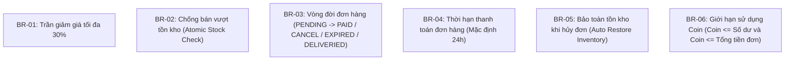

# TÀI LIỆU ĐẶC TẢ YÊU CẦU DỰ ÁN (PRD - PRODUCT REQUIREMENTS DOCUMENT)
## HỆ THỐNG THƯƠNG MẠI ĐIỆN TỬ CỬA HÀNG THỜI TRANG (CLOTHING SHOP)

---

## 1. TỔNG QUAN DỰ ÁN (PROJECT OVERVIEW)

### 1.1. Giới thiệu
Hệ thống **Clothing Shop** là nền tảng thương mại điện tử chuyên biệt cho lĩnh vực thời trang (quần áo, váy đầm, set đồ thời trang, đồ thể thao). Dự án được xây dựng với mục tiêu cung cấp giải pháp backend mạnh mẽ, linh hoạt và toàn diện nhằm đáp ứng đầy đủ chu trình mua sắm trực tuyến từ khâu duyệt sản phẩm, phân loại mẫu mã (màu sắc, kích thước), áp dụng chương trình khuyến mãi tự động, quản lý giỏ hàng, đặt hàng, quản lý kho hàng và xử lý khiếu nại hoàn trả sản phẩm.

### 1.2. Mục tiêu hệ thống
- **Đối với khách hàng:** Trải nghiệm mua sắm mượt mà, dễ dàng tìm kiếm sản phẩm theo danh mục và từ khóa, theo dõi giỏ hàng, nhận ưu đãi từ sự kiện giảm giá, tích lũy và sử dụng đồng xu (Coin) để trừ tiền trực tiếp trên đơn hàng, quản lý đơn hàng minh bạch.
- **Đối với quản trị viên (Admin) & Nhân viên:** Quản lý tập trung danh mục sản phẩm, biến thể chi tiết (SKU - kích thước, màu sắc), điều phối nhập kho và kiểm soát biến động tồn kho, thiết lập các chiến dịch Flash Sale/Sự kiện giảm giá theo thời gian thực, quản lý trạng thái xử lý đơn hàng và yêu cầu hoàn trả.
- **Mục tiêu kỹ thuật:** Đảm bảo tính toàn vẹn dữ liệu giao dịch trong môi trường nhiều người dùng, chống bán vượt tồn kho (overselling) thông qua kiểm soát giao dịch và khóa đồng thời (concurrency control), tối ưu hóa hiệu năng truy vấn với JPA Specifications và Spring Data Projections.

### 1.3. Phạm vi tài liệu
Tài liệu PRD này đặc tả toàn bộ yêu cầu nghiệp vụ, luồng dữ liệu, quy tắc xử lý và các chức năng của phân hệ backend thuộc mã nguồn `BTL-TTCS/back-end`.

---

## 2. PHÂN QUYỀN VÀ CHÂN DUNG NGƯỜI DÙNG (USER ROLES & PERSONAS)

| Vai trò (Role) | Mô tả vai trò | Quyền hạn chính |
| :--- | :--- | :--- |
| **Khách hàng (USER)** | Người dùng đã đăng ký tài khoản và đăng nhập vào hệ thống | - Xem thông tin tài khoản, cập nhật mật khẩu<br>- Tìm kiếm, lọc và xem chi tiết sản phẩm, biến thể, bình luận<br>- Quản lý giỏ hàng (thêm, xem, xóa mặt hàng)<br>- Đặt hàng, sửa thông tin nhận hàng & áp dụng coin trước khi thanh toán, hủy đơn khi còn PENDING<br>- Đánh giá và bình luận sản phẩm sau khi trải nghiệm<br>- Tạo yêu cầu đổi/trả hàng (Refund Request) |
| **Quản trị viên (ADMIN)** | Quản lý toàn bộ hệ thống cửa hàng thời trang | - Quản lý danh sách người dùng trong hệ thống (tra cứu, lọc trạng thái)<br>- Quản lý danh mục và thông tin sản phẩm (thêm mới, chỉnh sửa)<br>- Nhập kho, thiết lập giá bán, cập nhật số lượng và trạng thái biến thể<br>- Tạo và quản lý sự kiện khuyến mãi, gán sản phẩm vào sự kiện<br>- Điều phối đơn hàng (xác nhận giao hàng `DELIVERIED`, theo dõi doanh thu)<br>- Tiếp nhận và xử lý yêu cầu đổi trả hàng (`ACCEPTED`, `REJECTED`, `DONE`) |
| **Khách vãng lai (GUEST)** | Người dùng chưa đăng ký hoặc chưa đăng nhập | - Xem danh sách sản phẩm, lọc theo danh mục và từ khóa<br>- Xem danh sách sự kiện giảm giá đang hoặc sắp diễn ra<br>- Đăng ký tài khoản người dùng mới |

---

## 3. ĐẶC TẢ YÊU CẦU CHỨC NĂNG (FUNCTIONAL REQUIREMENTS)

### 3.1. Phân hệ Xác thực & Người dùng (Authentication & User Management)
- **FR-AUTH-01 (Đăng ký tài khoản):**
  - Người dùng cung cấp: `username`, `email`, `password`, `confirmPassword`.
  - Hệ thống kiểm tra: `username` và `email` phải là duy nhất trên toàn hệ thống; `password` và `confirmPassword` phải trùng khớp; các trường bắt buộc không được để trống.
  - Sau khi đăng ký thành công, tài khoản mặc định có trạng thái `ACTIVE`, vai trò `USER`, số dư tích lũy ban đầu là `0 coin`.
- **FR-USER-01 (Đổi mật khẩu):**
  - Người dùng xác thực cung cấp: `email`, `oldPassword`, `newPassword`, `confirmPassword`.
  - Hệ thống kiểm tra: Email phải khớp với tài khoản hiện tại, mật khẩu cũ phải chính xác, mật khẩu mới phải khớp với xác nhận mật khẩu và không được trùng với mật khẩu cũ.
- **FR-USER-02 (Tra cứu & Quản lý danh sách người dùng - Admin):**
  - Quản trị viên tra cứu danh sách người dùng có phân trang (`page`, `size`) và tìm kiếm theo từ khóa `username`.
  - Hệ thống tự động lọc bỏ các tài khoản có vai trò `ADMIN` trong danh sách người dùng thông thường.
  - Hỗ trợ sắp xếp đa tiêu chí linh hoạt (theo username, email, phone, v.v.).
  - Thông tin trả về được bảo mật (loại bỏ trường `password` qua Data Projection `UserInfoWithoutPassProjection`).
- **FR-USER-03 (Quản lý điểm thưởng / Xu - Coin):**
  - Người dùng có thể tích lũy Coin qua quá trình mua sắm hoặc hoàn tiền.
  - Coin được sử dụng để giảm trừ trực tiếp vào tổng tiền thanh toán của đơn hàng (1 Coin = 1 VNĐ).

---

### 3.2. Phân hệ Quản lý Danh mục & Sản phẩm (Product Catalog Management)
- **FR-PROD-01 (Tạo mới sản phẩm cha - Admin):**
  - Quản trị viên nhập thông tin sản phẩm: Tên sản phẩm (`productName`), mô tả (`description`), thể loại (`category`), đường dẫn ảnh đại diện (`imageUrl`).
  - Danh mục sản phẩm thuộc enum: `PANTS` (Quần), `SHIRT` (Áo), `DRESS` (Váy/Đầm), `SET` (Bộ đồ), `SPORTSWEAR` (Đồ thể thao).
  - Quy tắc kiểm tra: Tên sản phẩm không được trùng lặp trong hệ thống (kiểm tra không phân biệt chữ hoa, chữ thường `existsByNameIgnoreCase`).
- **FR-PROD-02 (Cập nhật thông tin sản phẩm - Admin):**
  - Cho phép quản trị viên chỉnh sửa tên, mô tả, phân loại danh mục, ảnh đại diện của sản phẩm dựa trên `productId`.
  - Kiểm tra nếu tên sản phẩm bị trùng với sản phẩm khác đã tồn tại trong cơ sở dữ liệu thì từ chối cập nhật.
- **FR-PROD-03 (Tìm kiếm và lọc danh sách sản phẩm - Public):**
  - Hỗ trợ tìm kiếm theo tên sản phẩm (không phân biệt chữ hoa, chữ thường).
  - Lọc chính xác theo danh mục phân loại (`category`).
  - Hỗ trợ phân trang linh hoạt (`page`, `size`) và sắp xếp đa tiêu chí (`sortBy`, `sortDir` như theo tên, id).
  - Trả về đối tượng `ProductProjection` gọn nhẹ nhằm tối ưu băng thông mạng.
- **FR-PROD-04 (Xem chi tiết sản phẩm):**
  - Trả về thông tin đầy đủ của sản phẩm: thông tin cơ bản, danh sách các biến thể chi tiết (SKU kèm kích thước, màu sắc, giá bán, tồn kho) và các bình luận/đánh giá của khách hàng.

---

### 3.3. Phân hệ Quản lý Biến thể & Kho hàng (Product Variant & Inventory)
- **FR-VAR-01 (Phân loại biến thể theo Size & Color):**
  - Mỗi sản phẩm (`Product`) có nhiều biến thể (`ProductVariant`).
  - Biến thể được định danh bởi cặp thuộc tính duy nhất trên cùng sản phẩm: **Màu sắc (`Color`)** và **Kích cỡ (`Size`)**.
  - Bảng kích cỡ tiêu chuẩn gồm: `S`, `M`, `L`, `XL`, `XXL`, `XXXL`.
  - Trạng thái biến thể (`status`): `COMING` (Sắp về), `AVALIBLE` (Có sẵn/Đang bán), `UNAVALIBLE` (Ngừng kinh doanh/Hết hàng).
- **FR-VAR-02 (Nhập kho / Thêm biến thể mới - Admin):**
  - Quản trị viên nhập thông tin: `colorName`, `size`, `quantity`, `importCost`.
  - Quy trình nghiệp vụ:
    - Nếu màu sắc chưa tồn tại trong hệ thống, tự động thêm mới vào bảng `color`.
    - Kiểm tra xem biến thể của sản phẩm ứng với màu và cỡ đó đã tồn tại chưa:
      - Nếu **chưa tồn tại**: Tạo mới biến thể với số lượng nhập ban đầu, giá bán mặc định bằng giá vốn, trạng thái `AVALIBLE`.
      - Nếu **đã tồn tại**: Tăng số lượng tồn kho tương ứng bằng lệnh cập nhật an toàn (`increaseStock`).
    - Tự động ghi nhận một bản ghi vào lịch sử nhập hàng (`ImportHistory`) lưu trữ: mã biến thể, số lượng nhập, giá nhập và thời gian nhập.
- **FR-VAR-03 (Điều chỉnh giá bán & trạng thái biến thể):**
  - Cho phép điều chỉnh giá bán lẻ (`purchasePrice`), số lượng tồn kho thực tế và cập nhật trạng thái kinh doanh (`AVALIBLE`, `UNAVALIBLE`, `COMING`).
  - Cơ chế cập nhật đảm bảo an toàn giao dịch với khóa bi quan (Pessimistic Lock).

---

### 3.4. Phân hệ Sự kiện & Chương trình Khuyến mãi (Promotions & Events)
- **FR-EVT-01 (Tạo mới sự kiện khuyến mãi - Admin):**
  - Nhập thông tin sự kiện: Tiêu đề (`title`), mô tả (`description`), tỷ lệ giảm giá (`discount` theo phần trăm), ngày bắt đầu (`startAt`), ngày kết thúc (`endAt`).
  - Ràng buộc nghiệp vụ:
    - Tiêu đề sự kiện không được trùng lặp.
    - Tỷ lệ giảm giá phải nằm trong khoảng: `1% <= discount <= 30%` (ràng buộc kiểm tra cả tầng ứng dụng và Database CHECK constraint).
    - Ngày bắt đầu phải diễn ra trước ngày kết thúc (`startAt < endAt`).
- **FR-EVT-02 (Cập nhật sự kiện & Áp dụng sản phẩm khuyến mãi - Admin):**
  - Cho phép sửa đổi tiêu đề, mô tả, thời gian diễn ra và mức giảm giá.
  - Thiết lập danh sách các sản phẩm (`productIds`) được hưởng chiết khấu của sự kiện (lưu vào bảng liên kết `product_event`).
- **FR-EVT-03 (Tìm kiếm & Tra cứu sự kiện):**
  - Tra cứu sự kiện theo từ khóa trong tiêu đề (`keyword`).
  - Lọc theo trạng thái sự kiện:
    - `COMING`: Sự kiện sắp diễn ra (`startAt > LocalDate.now()`).
    - `AVAILABLE`: Sự kiện đang có hiệu lực (`startAt <= LocalDate.now() <= endAt`).
    - `ENDED`: Sự kiện đã kết thúc (`endAt < LocalDate.now()`).
  - Lọc theo khoảng thời gian diễn ra (`isAvailableBetween`).
  - Phân trang và sắp xếp theo ngày bắt đầu hoặc tỷ lệ giảm giá.
- **FR-EVT-04 (Quy tắc cộng dồn và giới hạn chiết khấu khi mua hàng):**
  - Một sản phẩm có thể tham gia nhiều sự kiện diễn ra đồng thời.
  - Tỷ lệ chiết khấu được tính bằng tổng chiết khấu của tất cả các sự kiện hợp lệ tại thời điểm hiện tại:
    $$\text{Discount} = \min\left(\sum \text{Event.discount}, 30\%\right)$$
  - **Trần tối đa chiết khấu luôn bị khống chế ở mức 30%**.

---

### 3.5. Phân hệ Quản lý Giỏ hàng (Shopping Cart Management)
- **FR-CART-01 (Thêm sản phẩm biến thể vào giỏ hàng):**
  - Khách hàng chọn biến thể cụ thể (`productVariantId`) để thêm vào giỏ.
  - Nếu biến thể đã tồn tại trong giỏ của người dùng, hệ thống thông báo lỗi trùng lặp (tránh nhân bản dòng dữ liệu).
  - Số lượng mặc định khi mới thêm là `1`.
- **FR-CART-02 (Xem danh sách giỏ hàng):**
  - Trả về danh sách mặt hàng trong giỏ của người dùng đang đăng nhập có phân trang.
  - Mỗi mục giỏ hàng thể hiện: ID giỏ hàng, số lượng, tên kết hợp đầy đủ: `<Tên sản phẩm> - <Màu sắc> - <Kích cỡ>` (ví dụ: `Áo Sweater - Đỏ - L`).
- **FR-CART-03 (Xóa mặt hàng khỏi giỏ hàng):**
  - Cho phép người dùng chọn một hoặc nhiều mặt hàng trong giỏ hàng để xóa hàng loạt (`deleteAllByIdInBatch`).
  - Hệ thống kiểm tra tính tồn tại của các mục giỏ hàng trước khi thực thi lệnh xóa.

---

### 3.6. Phân hệ Xử lý Đơn hàng (Order Processing & Checkout Lifecycle)
- **FR-ORD-01 (Quy trình khởi tạo đơn hàng - Checkout Orchestration):**
  - Khách hàng gửi yêu cầu tạo đơn gồm: thông tin người nhận (`reciverName`, `reciverPhone`, `reciverAddress`) và danh sách các mục trong giỏ muốn mua (`orderItems` gồm `cartItemId`, `quantity`).
  - **Quy trình kiểm tra & thực thi nguyên tử (`@Transactional`):**
    1. *Xác thực mục giỏ hàng:* Tất cả các `cartItemId` gửi lên phải thực sự thuộc sở hữu của người dùng hiện tại.
    2. *Kiểm tra trạng thái hàng:* Toàn bộ các biến thể tương ứng phải ở trạng thái `AVALIBLE`.
    3. *Trừ kho nguyên tử (Atomic Conditional Stock Deduction):* Trừ số lượng tồn kho `quantity = quantity - buyQuantity` với điều kiện `quantity >= buyQuantity`. Nếu không đủ hàng, lập tức hủy giao dịch và thông báo thiếu hàng.
    4. *Tính toán giá và chiết khấu:* Xác định mức chiết khấu hiện hành của sản phẩm cha từ các sự kiện hợp lệ (tối đa 30%). Tính đơn giá thực tế:
       $$\text{Giá áp dụng} = \text{purchasePrice} \times \frac{100 - \text{discount}}{100}$$
    5. *Tạo đơn hàng:* Tạo bản ghi `Order` với trạng thái ban đầu là `PENDING`, thiết lập thời hạn thanh toán mặc định là 24 giờ kể từ thời điểm đặt (`expriredat = createdAt + 1 day`), tạo các bản ghi `OrderItem`.
    6. *Dọn dẹp giỏ hàng:* Tự động xóa các mục giỏ hàng đã được chuyển đổi thành đơn hàng.
- **FR-ORD-02 (Cập nhật thông tin nhận hàng & Tiêu dùng Coin):**
  - Áp dụng khi đơn hàng đang ở trạng thái `PENDING`.
  - Cho phép người dùng chỉnh sửa thông tin người nhận: tên, địa chỉ, số điện thoại.
  - Cho phép áp dụng số dư Coin để thanh toán:
    - Kiểm tra số dư Coin của người dùng phải lớn hơn hoặc bằng số Coin muốn dùng.
    - Số Coin muốn dùng không được vượt quá tổng tiền của đơn hàng.
    - Cập nhật số Coin đã dùng vào `order.coinUsed` và trừ trực tiếp Coin trong tài khoản người dùng `user.coin`.
- **FR-ORD-03 (Hủy đơn hàng - Order Cancellation):**
  - Khách hàng chỉ được quyền tự hủy đơn khi đơn hàng đang ở trạng thái `PENDING`.
  - Hệ thống chuyển trạng thái đơn hàng sang `CANCEL`.
  - **Tự động hoàn trả tồn kho (Restore Inventory):** Hoàn trả lại số lượng từng biến thể vào kho hàng thông qua câu lệnh `increaseStock`.
- **FR-ORD-04 (Xác nhận giao hàng - Admin):**
  - Quản trị viên cập nhật trạng thái đơn hàng sang `DELIVERIED` khi hàng đã được giao thành công cho khách hàng.
- **FR-ORD-05 (Tra cứu & Lọc đơn hàng):**
  - Hỗ trợ tra cứu đơn hàng theo nhiều tiêu chí: Trạng thái đơn (`status`), khoảng ngày tạo (`startAt` - `endAt`), tên người nhận, số điện thoại, địa chỉ nhận hàng.
  - Phân trang và sắp xếp linh hoạt theo ngày tạo hoặc tên người nhận.
  - Xem chi tiết đơn hàng đầy đủ (`OrderWithItems`) gồm thông tin người nhận, thời gian, trạng thái, số xu đã dùng, danh sách từng sản phẩm biến thể (kèm ảnh, màu, cỡ, số lượng, giá và chiết khấu).

---

### 3.7. Phân hệ Bình luận & Đánh giá Sản phẩm (Reviews & Ratings)
- **FR-REV-01 (Đăng bình luận & đánh giá):**
  - Khách hàng đăng đánh giá cho sản phẩm với số sao từ `1` đến `5` sao (`star`) kèm nội dung nhận xét (`content`).
  - Ghi nhận thời gian tạo bình luận theo ngày hiện tại (`createdAt = LocalDate.now()`).
- **FR-REV-02 (Xem bình luận theo sản phẩm):**
  - Hiển thị danh sách đánh giá của sản phẩm cho mọi người dùng.
  - Thông tin hiển thị: Tên người đánh giá (`username`), ảnh đại diện (`avatar`), số sao, nội dung nhận xét, ngày đăng.
  - Hỗ trợ sắp xếp theo số sao hoặc thời gian đăng.

---

### 3.8. Phân hệ Yêu cầu Đổi / Trả hàng (Refund Requests)
- **FR-REF-01 (Tạo yêu cầu hoàn hàng - Khách hàng):**
  - Khách hàng tạo yêu cầu hoàn trả đối với từng sản phẩm trong đơn hàng đã mua (`orderItemId`), cung cấp lý do (`reason`), hình ảnh minh chứng (`image`), số lượng trả (`quantity`).
  - Trạng thái khởi tạo: `PENDING`.
- **FR-REF-02 (Xử lý yêu cầu hoàn trả - Admin):**
  - Quản trị viên kiểm tra lý do và hình ảnh minh chứng để cập nhật trạng thái: `ACCEPTED` (chấp thuận), `REJECTED` (từ chối), hoặc `DONE` (đã hoàn tất hoàn trả/hoàn tiền).

---

## 4. QUY TẮC NGHIỆP VỤ CỐT LÕI (CORE BUSINESS RULES)



1. **BR-01 (Giới hạn mức giảm giá):** Không có bất kỳ sự kiện đơn lẻ hoặc chương trình khuyến mãi kết hợp nào được phép giảm vượt quá **30%** giá trị sản phẩm. Mọi công thức tính toán đều phải áp dụng hàm `LEAST` hoặc `Math.min(discount, 30)`.
2. **BR-02 (Kiểm soát tồn kho thời gian thực):** Mọi thao tác giảm trừ tồn kho khi đặt hàng phải được thực thi ở mức cơ sở dữ liệu với điều kiện `quantity >= :buyQuantity`. Tuyệt đối không cho phép số lượng tồn kho của bất kỳ biến thể nào giảm xuống số âm.
3. **BR-03 (Quy tắc hủy đơn hàng):** Đơn hàng chỉ có thể bị hủy nếu đang ở trạng thái `PENDING`. Khi hủy thành công, toàn bộ số lượng của các mặt hàng trong đơn phải được hoàn trả lập tức vào kho hàng.
4. **BR-04 (Hạn thanh toán đơn hàng):** Mỗi đơn hàng được khởi tạo đều có thời gian hết hạn sau đúng 24 giờ (`expriredat = createdAt.plusDays(1)`).
5. **BR-05 (Quy tắc sử dụng Coin):** Khách hàng chỉ được phép sử dụng số Coin tối đa bằng số dư tài khoản sở hữu và không được vượt quá tổng tiền của đơn hàng trước khi thanh toán. Số Coin sử dụng sẽ bị trừ ngay khi cập nhật vào đơn hàng.
6. **BR-06 (Tính duy nhất của định danh biến thể):** Trên cùng một sản phẩm cha (`Product`), không được phép tồn tại 2 biến thể có cùng kích thước (`Size`) và cùng màu sắc (`Color`).

---

## 5. MA TRẬN TRÁCH NHIỆM & TRUY CẬP (RACI / PERMISSION MATRIX)

| Tính năng / Nghiệp vụ | Endpoint API | GUEST | USER | ADMIN |
| :--- | :--- | :---: | :---: | :---: |
| **Đăng ký tài khoản** | `POST /auth/register` | ✅ | ❌ | ❌ |
| **Đổi mật khẩu** | `PUT /user` | ❌ | ✅ | ✅ |
| **Tìm kiếm danh sách người dùng** | `GET /user` | ❌ | ❌ | ✅ |
| **Tạo mới sản phẩm** | `POST /product` | ❌ | ❌ | ✅ |
| **Cập nhật sản phẩm** | `PUT /product/{id}` | ❌ | ❌ | ✅ |
| **Tìm kiếm & lọc sản phẩm** | `GET /product` | ✅ | ✅ | ✅ |
| **Xem chi tiết sản phẩm** | `GET /product/{id}/detail` | ✅ | ✅ | ✅ |
| **Nhập kho / Thêm biến thể** | `POST /variant` | ❌ | ❌ | ✅ |
| **Tạo sự kiện khuyến mãi** | `POST /event` | ❌ | ❌ | ✅ |
| **Cập nhật sự kiện & áp dụng SP** | `PUT /event/{id}` | ❌ | ❌ | ✅ |
| **Xem & tìm kiếm sự kiện** | `GET /event` | ✅ | ✅ | ✅ |
| **Xem chi tiết sự kiện** | `GET /event/detail/{id}` | ✅ | ✅ | ✅ |
| **Thêm hàng vào giỏ** | `POST /cart/item/{variantId}` | ❌ | ✅ | ❌ |
| **Xem giỏ hàng** | `GET /cart` | ❌ | ✅ | ❌ |
| **Xóa hàng khỏi giỏ** | `DELETE /cart/item` | ❌ | ✅ | ❌ |
| **Tạo đơn hàng (Checkout)** | `POST /order` | ❌ | ✅ | ❌ |
| **Cập nhật thông tin đơn & dùng Coin**| `PUT /order/{id}/detail` | ❌ | ✅ | ❌ |
| **Hủy đơn hàng** | `PUT /order/{id}/detail/cancel` | ❌ | ✅ | ❌ |
| **Tra cứu danh sách đơn hàng** | `GET /order` | ❌ | ✅ (Đơn của mình) | ✅ (Tất cả đơn) |
| **Xem chi tiết đơn hàng** | `GET /order/{id}/detail` | ❌ | ✅ (Đơn của mình) | ✅ |
| **Xác nhận giao hàng thành công** | `PUT /order/{id}/send` | ❌ | ❌ | ✅ |
| **Viết bình luận sản phẩm** | `POST /product/{id}/comment/`| ❌ | ✅ | ❌ |
| **Xem danh sách bình luận** | `GET /product/{id}/comment` | ✅ | ✅ | ✅ |

---

## 6. YÊU CẦU PHI CHỨC NĂNG (NON-FUNCTIONAL REQUIREMENTS)

### 6.1. Tính toàn vẹn dữ liệu & Xử lý đồng thời (Concurrency & Data Integrity)
- **Ngăn chặn Race Condition:** Khi nhiều người dùng cùng mua một mặt hàng có số lượng tồn kho ít, hệ thống phải đảm bảo tính nhất quán qua lệnh cập nhật có điều kiện `decreseStock(...)`. Nếu số lượng tồn kho không đủ, giao dịch phải thất bại và hoàn tác an toàn.
- **Tính trọn vẹn của đơn hàng:** Việc trừ tồn kho, tạo đơn hàng, tạo các mục hàng và xóa giỏ hàng phải diễn ra trong một Transaction duy nhất (`@Transactional`). Bất kỳ lỗi phát sinh nào cũng phải kích hoạt Rollback toàn bộ.

### 6.2. Hiệu năng & Khả năng mở rộng (Performance & Scalability)
- **Tối ưu hóa truy vấn JPA/Hibernate:** Sử dụng Dynamic Projections (`UserInfoWithoutPassProjection`, `ProductProjection`, `OrderProjection`) để chỉ lấy đúng các cột cần thiết từ DB, giảm thiểu dung lượng bộ nhớ.
- **Loại bỏ vấn đề N+1:** Áp dụng `JOIN FETCH` và `@EntityGraph` trên các mối quan hệ `LAZY` (như `cartItems`, `orderItems`, `productVariants`) khi cần lấy dữ liệu lồng nhau.
- **Sẵn sàng Caching:** Đã tích hợp sẵn cấu hình kết nối Redis và thư viện Lettuce để có thể lưu bộ nhớ đệm cho các truy vấn thường xuyên như chi tiết sản phẩm, danh mục sự kiện đang chạy.

### 6.3. Tiêu chuẩn hóa API & Phản hồi (API Standardization)
- Toàn bộ kết quả phản hồi của các REST API đều được bao gói đồng nhất bởi lớp đối tượng `ApiResponse<T>`:
  ```json
  {
    "code": 200,
    "message": "Thông báo trạng thái thực thi",
    "data": { ... }
  }
  ```
- Xử lý ngoại lệ tập trung thông qua `@ControllerAdvice` với mã HTTP tiêu chuẩn (400 Bad Request, 404 Not Found, 500 Internal Server Error).

---

## 7. TIÊU CHÍ NGHIỆM THU (ACCEPTANCE CRITERIA)

| Mã tiêu chí | Kịch bản kiểm thử (Test Scenario) | Kết quả mong đợi |
| :--- | :--- | :--- |
| **AC-01** | Đăng ký tài khoản với email đã tồn tại | Hệ thống trả về HTTP 400 cùng thông báo "Email ... đã được sử dụng!" |
| **AC-02** | Đặt hàng khi số lượng tồn kho của biến thể ít hơn số lượng đặt | Giao dịch bị hủy bỏ, hệ thống báo lỗi không đủ số lượng tồn kho, không có đơn hàng nào được tạo |
| **AC-03** | Khách hàng áp dụng Coin vượt quá tổng tiền của đơn hàng | Hệ thống từ chối cập nhật, trả về HTTP 400 thông báo số tiền phải trả nhỏ hơn số coin sử dụng |
| **AC-04** | Hủy đơn hàng đang ở trạng thái `PENDING` | Trạng thái đơn đổi sang `CANCEL`, số lượng tồn kho của các biến thể trong đơn được cộng bù lại chính xác vào bảng `productvariant` |
| **AC-05** | Hủy đơn hàng khi trạng thái đã khác `PENDING` (ví dụ `DELIVERIED`) | Hệ thống từ chối và báo lỗi "Trạng thái không hợp lệ!" |
| **AC-06** | Tạo sự kiện khuyến mãi với mức giảm giá `35%` | Hệ thống báo lỗi validation vi phạm mức giảm tối đa 30% |
| **AC-07** | Nhập thêm hàng cho biến thể đã tồn tại | Số lượng trong kho tăng lên đúng bằng số lượng nhập, xuất hiện bản ghi tương ứng trong `importhistory` |

